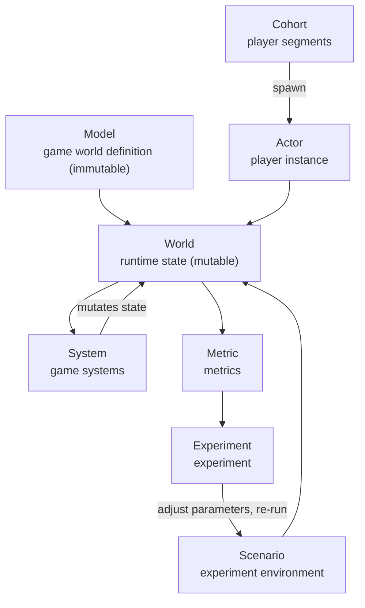
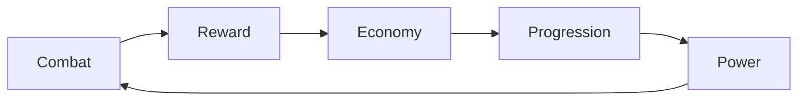

[English](03-concepts.en.md) | [中文](03-concepts.md)

# Core Concepts

Sandtable's core is not a feature list but seven modeling concepts:

```text
Model · Actor · Cohort · System · Scenario · Metric · Experiment
```

## Concept Relationships



## Model and World: Definition vs. State

::: warning Boundary must be drawn clearly
**Model is immutable** — the compiled product of the configuration, answering "what the game is": numbers, formulas, rule definitions. **World is mutable** — runtime state, holding the Clock, Event Queue, entity states, RNG cursor, and more. The Clock and Event Queue are runtime mechanisms, not part of "what the game is," so they belong to World rather than Model.
:::

| Belongs to | Contents | Lifecycle |
| --- | --- | --- |
| Model | Number tables, formulas, system parameters, behavior probability definitions | Constant within a single experiment; reusable across candidates |
| World | Entity states, Clock, Event Queue, RNG state, metric aggregators | Initialized independently for each run |

Model example (not tied to any specific game):

```yaml
stats:
  warrior:
    attack: 100
    defense: 80

monsters:
  slime:
    hp: 500
    defense: 30
```

## Actor: Player Behavior Model

An Actor describes "who is playing and how they act" — more than just a set of attributes:

```text
Actor
├── State          runtime state (level, gold, power, ……)
├── Attributes     static attributes
├── Goals          goals
├── Strategy       strategy
├── Schedule       activity schedule
├── Preferences    preferences
└── Decision Model decision model
```

Phase 1 adopts a simple, configurable behavior model:

```yaml
actor:
  type: casual
  activity:
    sessions_per_day: 2
    session_duration: 20m
  behavior:
    dungeon_probability: 0.7
    upgrade_probability: 0.2
    explore_probability: 0.1
```

More complex behavior models will come later; see [Configuration and Formula Engine](./07-config-formula.en) for the extension interface.

## Cohort: Player Segments

Cohort and Actor are kept separate:

- **Cohort** is the statistical / behavioral model of a class of players (the MVP ships Casual, Core, and Whale; additional segments are a future extension direction);
- **Actor** is a concrete player instance produced during the simulation run.

```text
Cohort → spawn → Actors → behavior → World → Metrics → Cohort Analysis
```

The MVP ships Casual / Core / Whale; the MVP definition of Whale (the substitute measure for when there is no payment system) is in [KPIs and Metrics](./13-kpi-metrics.en).

## System: Game Systems

A System describes how game systems change world state. Typical systems:

```text
Combat · Economy · Progression · Inventory · Reward · Activity · Daily Reset
```

Systems are allowed to form feedback loops with each other:



This is exactly where Sandtable differs importantly from a single-battle simulator: feedback loops make parameter effects accumulate, amplify, or decay over time, which a one-shot simulation cannot see.

## Scenario: Simulation Scenario

A Scenario describes "how one experiment runs":

```yaml
scenario:
  duration: 30d
  population: 10000
  population_mix:
    casual: 0.60
    core: 0.30
    whale: 0.10
  seed: 123456
```

::: tip Design commitment
The Model describes the game itself, the Scenario describes the experiment environment — **the two must be separated**. Running the same Model with different Scenarios (different populations, durations, seeds), or the same Scenario with a differently parameterized Model, is routine; there is no need to duplicate configuration files.
:::

## Metric: Metrics

A Metric describes "how to tell whether the system is running well." Supported forms:

```text
Scalar (win rate, churn rate, inflation……) · Time Series (per-day series) · Distribution (fixed snapshot-day P50 / P90 / P99) · Cohort (slicing)
```

```yaml
targets:
  combat.win_rate:
    min: 0.48
    max: 0.52
  economy.inflation:
    max: 0.05
  progression.day_7_power:
    min: 10000
    max: 15000
```

A Metric is not just a statistic computed after the simulation ends — it is part of the system's objective: constraint evaluation, candidate ranking, and balance recommendations are all built on Metrics (see [KPIs and Metrics](./13-kpi-metrics.en)).

## Experiment: Experiments

An Experiment describes "how to change parameters and compare results":

```text
Parameter Space → Simulation → Metrics → Constraints → Ranking → Recommendation
```

Phase 1 supports Grid Search, Random Search, Monte Carlo, and Parameter Sweep; Latin Hypercube has landed (2026-10-09, `mode: latin_hypercube`, see [Parameter Sweep](./12-parameter-sweep.en)); Evolutionary / Pareto optimization (the `optimize` subcommand) and random-forest surrogate (the `surrogate` subcommand) have landed; Bayesian / GP is left for on-demand implementation. The Experiment is a core model, not a script outside the CLI ([Experiment Pipeline](./11-experiment-pipeline.en)).
