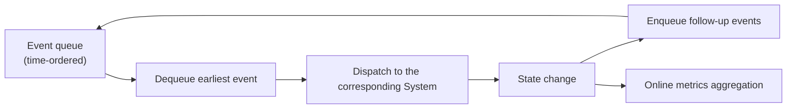
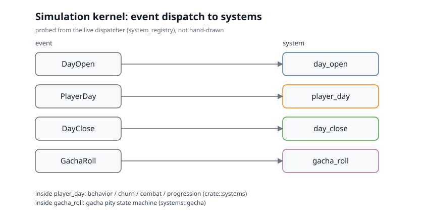

[English](/guide/04-kernel) | [中文](/zh/guide/04-kernel)

# Simulation Kernel

The Simulation Kernel is the most important technical asset of the entire project.

## Composition

```text
World
├── Clock          macro time (days) and event timestamps
├── RNG            keyed RNG derivation (see Deterministic RNG)
├── Entity Store   entity store (ordered containers guarantee deterministic iteration)
├── State          runtime state
├── Systems        system registry
└── Event Queue    discrete event queue
```

The kernel provides mechanisms only, not policies: it knows nothing about "how combat is calculated" or "how gold is paid out" — those are implemented by the Systems registered into it. In the MVP phase, Systems are provided in hardcoded form (see [MVP](./16-mvp.md)); configuration-driven Systems will be extracted afterward.

## Execution Loop

The macro timeline advances by discrete events (see [Why](./05-time-model.md)):



Two key points:

1. **Time only jumps between events.** No computation happens between two events, so within a day only the few dozen to few hundred events that actually occur are processed — instead of spinning at a fixed step.
2. **Metrics are updated incrementally as events are processed**, not by replaying per-entity detail afterward (see [Online Aggregation](./13-kpi-metrics.md)).

The full MVP event→system subscription map for the kernel (generated from source, kept in sync with the code):



The graph is generated by an example probing the real dispatch surface (`system_registry` shares the same system construction as the simulation execution, so the subscription matrix cannot drift from reality). Regeneration command (from the repository root):

```sh
cargo run -p sandtable-core --example system_graph
```

The `player_day` system internally selects an action by behavior band, settles combat, and advances progression; the `gacha_roll` system internally runs its pity state machine (see [MVP](./16-mvp.md)).

The copy committed to the repo is **reconciled edge by edge by tests**: add a system or change a subscription but forget to re-run the example, and CI goes red (the generated-artifact freshness guard, see [Testing Strategy](./19-testing.md)).

## Model Compilation and World Construction

Initialization order for one run:

```text
Config file → validation → compiled into Model (immutable)
→ World built from Scenario (entities, event queue, RNG, aggregators)
→ event-by-event advancement → metrics output
```

Model compilation happens before a run: formulas are parsed into executable form at this stage (see [Formula Engine](./07-config-formula.md)), and parameter paths are resolved to indices. No configuration string lookup happens at runtime.

## Parallelism Model

- **Experiment-level parallelism**: different candidates (parameter combinations) are independent of each other and run in parallel with rayon (see [Parameter Sweep](./12-parameter-sweep.md)). This is the primary parallelism in the MVP.
- **Player-level parallelism**: when the [player independence assumption](./01-positioning.md) holds, player states are independent and parallelism can be split per player. Where floating-point aggregation is involved, the parallel-determinism rules must be followed (see [Deterministic RNG](./06-deterministic-rng.md)).

## Platform Portability Boundary

The kernel's target platforms are **native (CLI / desktop) and wasm32 (browser)**. From Phase 1 onward, a CI gate guarantees that `cargo check --target wasm32-unknown-unknown` passes — compilation capability is not "to be filled in later" but an architectural commitment:

| Rule | Rationale |
| --- | --- |
| Core hot paths are **serially deterministic**: algorithms are written serially, and parallelism is a capability injected at the experiment layer (feature flag) | Parallel execution must already obey the determinism rules; under single-threaded WASM it automatically degrades to serial, with unchanged behavior |
| Core forbids file / network I/O, the `Instant::now` wall clock, and platform libraries (`duckdb` / `web-sys` / `tokio`) | Simulation time comes only from the simulated clock; platform adaptation lives in the shell layer (`sandtable-cli` / `sandtable-wasm` / desktop shell) |
| All random consumption goes through keyed derivation; integer / fixed-point arithmetic is preferred cross-platform | See the cross-platform notes in [Deterministic RNG](./06-deterministic-rng.md) |

::: warning One red line
The analysis engine must not enter core. `use duckdb::*` or `use web_sys::*` appearing in core is an architectural regression — core's dependency tree contains only pure Rust.
:::

## Architecture-Level Performance Constraints

- MVP target: 10,000 players × 30 days, completed in minutes on a developer machine ([compute rationale](./05-time-model.md)).
- Follow-up target: 100,000 players × 30–90 days. This requires metric collection to be online aggregation from day one; "store the details, aggregate afterward" is not an option — detail storage is infeasible at this scale (see [Online Aggregation](./13-kpi-metrics.md)).
- The kernel stays headless and I/O-independent: it takes configuration and a seed as input, produces metrics as output, and does not depend on network, database, or a graphical interface.
