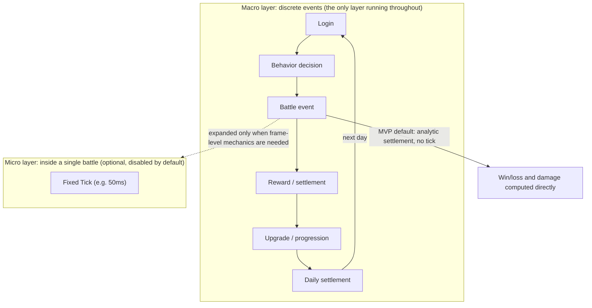

# Time Model

## Problem: Fixed Ticks Throughout Are a Compute Trap

If the simulation advances at a fixed tick the entire way (say one tick per 50ms), at MVP experiment scale:

```text
30 days = 2,592,000 seconds
2,592,000 seconds ÷ 0.05 seconds/tick ≈ 51.8 million ticks / player
× 10,000 players ≈ 5.2 × 10¹¹ state updates
```

5×10¹¹ updates far exceeds the [MVP performance target](#performance-targets) of "completing quickly on a developer machine." Conclusion: **fixed ticks throughout are not viable** — this is not an optimization problem but a model-selection problem.

## Approach: A Layered, Nested Time Model

The time model has two layers, **nested, not parallel**:



### Macro Layer: Discrete Events

Logins, battles, rewards, upgrades, daily settlements, offline earnings, and so on are all modeled as discrete events. The event queue is sorted by time, and time only jumps between events:

```text
Day 1 09:00  Login
Day 1 09:03  Battle
Day 1 09:05  Reward
Day 1 09:06  Upgrade
Day 1 10:00  Logout
```

Within a day, the events that actually occur for one player number only in the few dozen to few hundred. 10,000 players × 30 days × ~a hundred events/day ≈ **10⁷–10⁸ events in total**, 3–4 orders of magnitude below the 5×10¹¹ of fixed ticks — that is why this is feasible.

### Micro Layer: In-Battle Ticks (Optional)

Fixed Tick is used only inside a single battle, suited to frame-level mechanics: DPS, Buff / Debuff, cooldowns, positioning. A battle is **one event** at the macro layer; if that battle needs frame-level mechanics, a tick sub-simulation is expanded inside the event: it takes both sides' state as input, outputs win/loss and damage, and returns to the macro layer.

### MVP: Analytic Settlement

MVP battles do not run ticks; they use **analytic settlement**: given both sides' state and hit / damage formulas, the expected result is computed directly and randomized per the formula, yielding win/loss and losses in one pass. For turn-based games, or games where expectation-based settlement suffices, analytic settlement already covers the need; battle types that need frame-level mechanics will get a tick sub-simulation once real demand appears.

::: warning Decision record
"Fixed ticks throughout" and "layered nesting" are not two implementation styles — they differ by the gap between the two magnitudes 5×10¹¹ and 10⁷. Any proposal to move the macro layer back to fixed-step advancement must first redo this compute accounting.
:::

## Mechanism Layering Rules

| Mechanism | Layer | Rationale |
| --- | --- | --- |
| Login, offline earnings, daily settlement | Macro discrete events | Naturally occur in whole occurrences |
| Behavior decisions, rewards, upgrades | Macro discrete events | Event-shaped, with no continuous state evolution |
| Turn-based / expectation battles | Macro events (analytic settlement) | Expectation is computable in closed form |
| Frame-level Buff / cooldown / DPS | Micro ticks (optional) | Requires a continuous time axis |

## Performance Targets

The MVP does not chase extreme benchmarks, but the architecture must allow parallelism:

```text
MVP:  10,000 players × 30 days   minutes on a developer machine
Next: 100,000 players × 30~90 days
```

The primary granularity of parallelism is experiment-level (between candidates); player-level parallelism depends on the [player independence assumption](./01-positioning.md). The determinism rules for floating-point aggregation are in [Deterministic RNG](./06-deterministic-rng.md).
