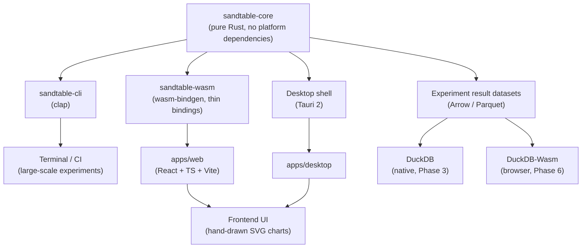

[English](08-tech-stack.en.md) | [中文](08-tech-stack.md)

# Technology Stack

## Language and Forms

The core implementation language is **Rust**. Rationale: high performance, memory safety, strong parallelism, a mature CLI ecosystem, compilable to WASM, embeddable in Tauri — suited to long-running large-scale simulation.

Core requirements:

```text
Deterministic · Headless · Parallel · Embeddable · Testable · Platform-portable
```

## Overall Architecture: One Kernel, Three Shells



The three forms share one kernel; **implementing a separate JS simulation for Web is strictly forbidden** — that would make Web and desktop results inconsistent, breaking the reproducibility commitment (see [Product Scope](./02-scope.en)).

## Selection Overview

| Layer | Technology | Phase |
| --- | --- | --- |
| Core | Rust | MVP |
| CLI | clap | MVP |
| **WASM bindings** | wasm-bindgen (**first-class architectural goal**: a `wasm32-unknown-unknown` compilation gate from Phase 1; the binding layer in Phase 6) | Gate MVP / bindings Phase 6 |
| **Web** | React + TypeScript + Vite | Phase 6 |
| **Desktop** | Tauri 2 (the primary form on Windows; Web UI + Rust backend, no Node / Python services) | Phase 7 |
| **Analytics (native)** | DuckDB (duckdb-rs: in-memory / file databases, Arrow interop, reads Parquet / CSV / JSON) | Phase 3 |
| **Analytics (browser)** | DuckDB-Wasm (single-threaded by default; WASM memory has an official 4GB cap, and browsers are stricter in practice) | Phase 6 |
| **Data contract** | Arrow / Parquet (MVP exception: JSON + CSV, but the schema is designed per the Arrow contract, see [Data Output](./09-data-output.en)) | Contract MVP / carriers Phase 2 |
| Serialization | serde + serde_json | MVP |
| Configuration (YAML) | serde_yaml_ng (selection rationale in [Configuration and Formula Engine](./07-config-formula.en)) | MVP |
| Error handling | thiserror (core) / anyhow (cli) | MVP |
| Random numbers | Self-implemented keyed derivation (SplitMix64 mixing, **no rand dependency**; see [Deterministic RNG](./06-deterministic-rng.en)) | MVP |
| Parallelism | rayon (feature flag; experiment-level parallelism only, degrades to serial under WASM, behavior unchanged) | MVP |
| Expression evaluation | Built-in minimal evaluator (compile at load time) | MVP |
| Data output | JSON + CSV | MVP |
| Testing | Built-in Rust tests + snapshots | MVP |
| Benchmark | criterion (**not introduced**, a planned item) | On demand |
| CI | GitHub Actions (including the wasm32 gate) | MVP |
| Charts | Zero chart libraries: hand-drawn SVG in the frontend, inline SVG in HTML reports; **ECharts not introduced** | Shipped (Phase 5) |
| System diagrams | React Flow (not introduced) | Later |
| Scripting extension candidate | rhai (evaluation item, undecided) | Later |
| Python bindings | sandtable-sim (pyo3 + maturin, import name `sandtable_sim`; the PyPI name `sandtable` is already taken, hence the separate name) | Shipped (scripting layer Phases 1–3) |
| Web API | Axum (**not needed by default**: local-first; introduced together with tokio only if a server is genuinely required) | On demand |

## Dependency Discipline

::: warning Red lines
- **Core's dependency tree contains only pure Rust**: `duckdb` / `web-sys` / `tokio` / any database client appearing in core is an architectural regression; all platform adaptation lives in the shell layer (cli / wasm / desktop shell);
- **The analytics engine must not touch simulation state**: DuckDB only reads the result datasets; simulation state is Rust structs (see [Data Output](./09-data-output.en));
- Check license compatibility before introducing any dependency (an Apache-2.0 project excludes AGPL dependencies; example: evalexpr);
- criterion appears on the Benchmark line only; do not mix it into test records.
:::

## Crate Layout

The MVP splits only two crates, avoiding over-engineering; platform shells and thin binding / contract shells are added by phase:

| Crate / directory | Responsibility | Phase |
| --- | --- | --- |
| `sandtable-core` | Kernel + configuration + experiment: model / config / rng / time / world / systems / metrics / experiment | MVP |
| `sandtable-cli` | clap command line, thin wrapper over core | MVP |
| `sandtable-wasm` | wasm-bindgen thin bindings (`run_simulation` / `validate_config`, etc., **no simulation logic**) | Phase 6 |
| `sandtable-python` | pyo3 + maturin thin bindings (`load / run / sweep / recommend / params` read-only surface + Phase 3 day-granularity read-state callback `run_with_day_hook`, **no simulation logic**) | Scripting layer Phases 1–3 (landed 2026-10-11) |
| `sandtable-engine` | Engine-agnostic JSON contract thin shell (contract export (valid-value discipline) / reference importer / return conventions, **no simulation logic**) | Engine adapter (landed 2026-10-14, inspection R1 decides) |
| `apps/web` | React + TS + Vite frontend | Phase 6 |
| `apps/desktop` | Tauri 2 shell | Phase 7 |
| `sandtable-analytics` | Spun out only if the analytics layer (DuckDB queries, dataset construction) grows | Evaluate on demand |

::: warning Naming convention
Built-in systems (combat, economy, progression, etc.) live in a module called **`systems`** inside core. If they are split out as a crate in the future, name it `sandtable-systems` — **not `sandtable-model`**, to avoid colliding with the conceptual Model (the compiled product of configuration).
:::

## Principles

> Keep core as pure Rust as possible: no Web dependency, no database dependency, no dependency on any specific game engine; local-first, no server and no accounts by default.

core does not depend on cli / wasm; systems does not depend on experiment; the kernel does not depend on any upper layer; the analytics layer is called only by the shell layer.
