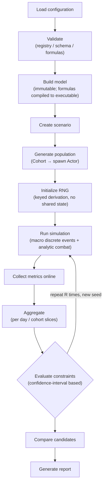

[English](11-experiment-pipeline.en.md) | [中文](11-experiment-pipeline.md)

# Experiment Pipeline

## The full pipeline

## Key steps explained

- **Build model**: the configuration is validated and compiled at this stage (formula compilation, parameter path resolution), with zero string lookups at runtime ([formula engine](./07-config-formula.en));
- **Run simulation**: one run of one candidate; the macro layer advances by discrete events and combat resolves analytically ([Time model](./05-time-model.en));
- **Collect metrics online**: histograms and statistics are updated incrementally while events are processed, with no per-individual detail stored ([online aggregation](./13-kpi-metrics.en));
- **Evaluate constraints**: [hard / soft verdicts are confidence-interval based](./13-kpi-metrics.en), not point estimates.

## Replicates: repeat count and population size are different things

::: warning Statistical unit
10,000 players ≠ 10,000 independent samples. Players within the same run share the model and the event structure and are correlated with each other. **The statistical unit is "one complete run" (a replicate)**: one replicate first aggregates players into a single metric value; only R replicates (different seeds) constitute R approximately independent samples.
:::

Confidence intervals are computed at the replicate level (formulas in [KPI and metrics](./13-kpi-metrics.en)); R defaults to 5–10, and budget-sensitive metrics can be coarse-screened with 3 seeds first.

## Parallelism and budget

- Candidates run in parallel (rayon); replicates within a candidate can also run in parallel;
- Cost = number of candidates × R × per-run cost; a grid design for a [parameter sweep](./12-parameter-sweep.en) must pass this arithmetic first;
- Each replicate of each candidate writes its own directory, so a failed replicate does not pollute completed results ([output conventions](./09-data-output.en)).
