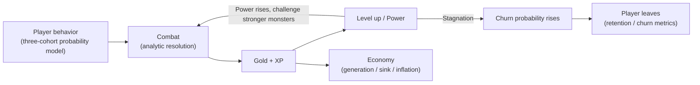

# MVP

The MVP is not accepted by feature count — it is accepted by whether **one minimal but complete closed loop** holds.

## The Loop



```text
Player → Fight Monster → Gold + XP → Level Up → Power Increase
→ Fight Stronger Monster → More Reward → ↺
```

Systems involved: Combat · Economy · Progression · Reward · Actor.

## Hardcode It, Just Get It Running

::: tip Vertical-slice principle
The minimal RPG in the MVP is **fully hardcoded** (values, probabilities, and curves written in code) — no configuration-driven layer. Rationale: a working closed loop is the first goal; "build the generic kernel first, then the game" tends to skew the abstractions. Configuration-driven loading, the formula engine, and the parameter registry are extracted only after the loop is validated (see the [roadmap](./18-roadmap.md) Phase 2). The only tunable parameters in the MVP are the seed and a handful of experiment switches.
:::

## Experiment Setup

```text
10,000 players · 30 days · R replicates (default 5)
Casual 60% · Core 30% · Whale 10% (Whale = high activity + growth multiplier, see metric definitions)
```

Output checkpoints: Day 1 / 3 / 7 / 14 / 30.

## Metric Set

All formulas follow [KPIs and metrics](./13-kpi-metrics.md):

```text
Win Rate · Churn Rate
Retention (D1 / D3 / D7 / D14 / D30)
Gold stock · Income / Spending
Inflation (daily growth rate of stock) · Sink Ratio
Mean power per day + snapshot-day P50 / P90 / P99 (D1~D30) · level-ups
Expected pulls per draw (when gacha is configured)
```

## A/B Comparison

The signature experiment of the MVP: attack 100 vs 105, same seed group (keyed RNG guarantees comparable paths):

```text
ΔD7 Power · ΔD7 Gold · ΔWinRate · ΔProgression · ΔInflation
Each delta ships with a CI₉₅ and effect size d
```

If this report can be produced stably and reproducibly, and the delta directions match the mechanism explanations, Sandtable's core value (relative comparison) is validated.

## Modeling Assumptions (Restated)

Players are independent, PvE only, and the economy is an aggregate metric (see [positioning](./01-positioning.md)). All MVP design and acceptance happens within this premise.

## Acceptance Criteria

```text
Configure (experiment switches) → Build world → Generate player population → Players act → Combat
→ Gain resources → Progress → Keep playing → Time advances (30 days) → Collect KPIs
→ Change parameters → Rerun → Compare results → Give parameter recommendations
```

| # | Criterion | Pass condition |
| --- | --- | --- |
| 1 | Loop runs | 10,000 players × 30 days fully runs with no manual intervention |
| 2 | Metrics produced | All metrics above are output per their formulas, with CI |
| 3 | A/B comparison | The `simulate` + `compare` subcommands produce a delta report with CI |
| 4 | Determinism | Same seed, rerun — summary matches bit-for-bit |
| 5 | Correctness | Analytic-solution cross-check tests pass (closed-form expected damage / expected reward, see [testing strategy](./19-testing.md)) |
| 6 | Performance | Completes in minutes on a dev machine (ordinary laptop) |
| 7 | Reproducibility | The [experiment identifier](./06-deterministic-rng.md) five-tuple is written to output |

All seven met → **Sandtable MVP holds**.

## What the MVP Explicitly Excludes

- Configuration-driven loading and the formula engine (Phase 2);
- Generic Kernel extraction (Phase 2, extracted from the slice);
- Sweep / sensitivity / recommendation (Phase 3–4);
- HTML reports (Phase 5);
- Monetization events and any player-to-player interaction.
