# Roadmap

## Method: Vertical Slicing

::: warning Why we dropped the "kernel first, game second" order
The original phasing had an inverted dependency: Phase 2 required "running the 30-day loop", but Metrics was scheduled for Phase 4 — without metrics the 30-day loop cannot be accepted. The more fundamental problem: **building the generic kernel first and the game second tends to skew the abstractions** (designing interfaces for an imaginary game).

Corrected to **vertical slicing**: first hardcode the minimal RPG into a runnable state (including the simplest metrics and one A/B comparison), verify the loop holds, then extract the generic kernel from the slice. Abstractions grow out of real code; they are not designed out of imagination.
:::

## Overview

```mermaid
flowchart LR
    P0["Phase 0<br>Definition (this document)"] --> P1["Phase 1<br>Minimal closed loop<br>(vertical slice)"]
    P1 --> P2["Phase 2<br>Kernel extraction and config-driven loading"]
    P2 --> P3["Phase 3<br>Experiment layer + analysis layer"]
    P3 --> P4["Phase 4<br>Sensitivity and recommendation"]
    P4 --> P5["Phase 5<br>Reports and real-config validation"]
    P5 --> P6["Phase 6<br>Web (WASM + React)"]
    P6 --> P7["Phase 7<br>Desktop (Tauri 2)"]
    P7 --> FU["Later<br>Optimization / scripting / bindings"]
```

::: tip Platform discipline
Web and Desktop are scheduled for Phase 6 / 7, **but their architectural preconditions are enforced by CI gates from Phase 1 on**: core must compile for `wasm32-unknown-unknown`, core's dependency tree must contain no platform libraries, and parallelism must be able to degrade to serial (see [simulation kernel](./04-kernel.md)). Features come later; boundaries do not.
:::

## Phase 0 — Definition (complete)

Core concepts, time model, RNG, metric formulas, constraint adjudication, and the roadmap are all written down (i.e., this site).

## Phase 1 — Minimal Closed Loop (Vertical Slice)

**Do**: hardcode the minimal RPG ([MVP definition](./16-mvp.md)): Actor probabilistic behavior + analytic combat + reward + progression + churn mechanics; advance 30 days day by day; the minimal implementation of the [metric formula set](./13-kpi-metrics.md) (WinRate / Power distribution / gold and inflation / retention and churn); CLI `simulate` + `compare`; one A/B report of attack=100 vs 105.

**Platform gates (in CI from this phase)**:
- `cargo check --target wasm32-unknown-unknown` passes (core pulls in no platform dependency);
- Output schema designed against the Arrow contract (column names / types map directly to RecordBatch, see [data output](./09-data-output.md)).

**Verify**:
- Deterministic snapshot: same seed, rerun, bit-for-bit identical;
- Analytic cross-check: closed-form expected damage and independent expected reward match the simulation mean ([testing strategy](./19-testing.md));
- All seven MVP acceptance items ([MVP](./16-mvp.md)) pass.

**Accept**: all seven items above met → MVP holds.

## Phase 2 — Kernel Extraction and Configuration-Driven Loading

**Do**: extract the generic World / event queue / Clock / keyed RNG / online-aggregation metrics from the slice; introduce YAML configuration (Model and Scenario separated), the parameter registry, config_hash, schema_version, and the formula engine (compiled at load time); parameterize Cohorts; move the built-in systems into the `systems` module with behavior unchanged; provide Arrow / Parquet export as a feature (the MVP's JSON + CSV stay the default).

**Accept**:
- After extraction, the same experiment's results are **bit-for-bit identical** to Phase 1 (refactor changes no behavior);
- The same YAML keeps config_hash unchanged after key reordering and added comments;
- The same experiment runs by changing config, not code.

## Phase 3 — Experiment Layer + Analysis Layer

**Do**: Grid / Random sweeps, replicates orchestration, candidate parallelism (rayon), the `sweep` subcommand, confidence-interval-based constraint adjudication, and comparison reports; **DuckDB analysis layer (native)**: duckdb-rs reads the result datasets (Parquet / CSV) for after-the-fact SQL exploration (per-cohort power, economic income/expense, etc.), never entering the simulation path.

**Accept**: after changing a parameter range, candidate experiments are auto-generated and compared; constraint adjudication outputs the three states PASS / BORDERLINE / FAIL (see [metrics](./13-kpi-metrics.md)).

## Phase 4 — Sensitivity and Recommendation

**Do**: OAT elasticity (extracted from grid data), single-parameter-axis interpolation recommendation intervals, Confidence criteria, and the `recommend` output.

**Accept**: parameter intervals with confidence can be derived from experiment results rather than raw data alone; interval endpoints are traceable to the interpolation process.

## Phase 5 — Reports and Real-Config Validation

**Do**: HTML reports (charts, KPIs, parameter comparison); **real-config validation node** — take a real or publicly documented game's numeric configuration and run it through the whole pipeline; evaluate Excel / CSV config import.

**Accept**: an external configuration (not the minimal RPG) runs end to end through simulate → sweep → recommend, exposing and fixing real integration friction. **Done**: the Pokémon (Gen 1 Kanto) case is integrated, the whole chain runs with zero model changes; the friction list and follow-up candidates are in [real-config validation](./21-pokemon-case.md); CSV import landed as `params export / import` (see [CLI](./10-cli.md)).

## Phase 6 — Web (WASM + React)

**Do**: `sandtable-wasm` thin bindings (run_simulation / validate_config, no simulation logic inside); React + TS + Vite frontend; DuckDB-Wasm local analysis; "Try in your browser" — open the page, import a [project file](./09-data-output.md) or config, run a small-to-medium simulation locally, and charts appear directly, zero install.

**Progress**: the bindings, frontend skeleton, and DuckDB-Wasm query panel have landed (config editing → local simulation → KPI / per-day curves / cohort table → SQL query with chart output, equivalence locked by tests, see [Web](./22-web.md)); result export has landed (`days.csv` / `report.json` downloads, isomorphic with the CLI `simulate --out` artifacts); frontend sweeping has landed (single-axis grid sweep + constraint adjudication table + recommendation band visualization, JS drives candidate by candidate, executed locally within the budget gate).

**Boundaries**: Web only promises small-to-medium simulations (DuckDB-Wasm is single-threaded by default, WASM memory is capped at 4GB); large sweeps with ten-thousand-scale players are steered toward the CLI / Desktop.

**Accept**: browser and CLI with the same config and same seed produce statistically equivalent results ([testing strategy](./19-testing.md)); results can be queried and charted via DuckDB-Wasm. **Done**: equivalence is locked value-by-value by the `web_parity` test, and the DuckDB-Wasm query panel has landed — see [Web](./22-web.md).

## Phase 7 — Desktop (Tauri 2)

**Do**: a Tauri 2 shell (React UI + Rust backend), native simulation + native DuckDB + local files; the primary form factor for Windows and similar platforms, with no Node / Python backend.

**Accept**: the desktop client runs the full experiment flow equivalently to the CLI; installers are usable on Windows / macOS.

**Dependency assessment (2026-10-10: green to start, no dependency blockers) → decision to start made (2026-10-10)**:

- **Technical side**: Tauri 2.x is the current stable line (stable since 2024-10, still actively maintained in 2026; the updater plugin requires Rust 1.90+); the architecture matches this section's charter — the `apps/desktop` shell (see the shell placement convention in [project structure](./17-project-structure.md)) + `sandtable-core` connected directly as a path dependency (native simulation, no wasm boundary) + `duckdb-rs` reading Parquet/CSV (the same dependency as the Phase 6 native analysis layer) + reusing apps/web's React 19 + Vite 8 frontend (Tauri natively supports Vite build artifacts). Zero changes on the core side: the CI gates already force core to compile for wasm32, keep its dependency tree free of platform libraries, and allow parallelism to degrade to serial.
- **CI / packaging**: the official `tauri-apps/tauri-action` supports a three-platform matrix; Windows / macOS runners need zero extra dependencies (WebView2 / WKWebView ship with the OS), while the Linux runner needs webkit2gtk-4.1 and about 8 other apt packages; the binaries use the system WebView and are far smaller than Electron.
- **Risks**: code signing (Windows SmartScreen / macOS Gatekeeper) is a release-quality bar, not a technical blocker; being unsigned only affects the first-launch experience.
- **Decision (2026-10-10)**: ① platform priority is **Linux local first** (the shell is developed and accepted on the local machine; Windows/macOS come later); ② **no auto-updater for now** (the verification channel is manual install first, updater in phase two); ③ the signing certificate is **deferred to release time**; ④ start order: shell + minimal runnable direct core path connection → frontend integration → experiment flow aligned with the CLI and accepted.
- **Progress**: the shell has started and integrated the frontend (2026-10-10) — `apps/desktop/src-tauri` (tauri 2.12 + tauri-build 2.7, a workspace member); the 7-command surface (`validate_config` / `run_simulation` / `cancel_run` / `sweep_plan` / `sweep_candidate` / `sweep_recommend` / `query`) is field-for-field isomorphic with the wasm bindings, core is connected directly without crossing the wasm boundary, error prefixes share a source, and native has no WASM 64-replicates / 200-budget gate; duckdb-rs (bundled + parquet) is wired into the `query` command — local result files register views by file stem and run SQL against them, same source as the CLI `query` (read-only results red line, is_ident blocks injection, DESCRIBE fetches column names); `apps/web` reuses the entire React UI (simulation + sweeping + query) with zero changes via the desktop branch of `lib/wasm.ts` (`__TAURI_INTERNALS__` detection → `invoke`), going through the native command surface on desktop, with the web build artifacts inlined via `frontendDist`; **all four GUI steps of the experiment flow are wired (2026-10-11)**: simulate → `run_simulation`, sweep → `sweep_plan` / `sweep_candidate`, recommend → `sweep_recommend` are all connected, and `query` completes them — native commands are surfaced in the UI, plus a new "local result file analysis" panel (tauri-plugin-dialog picks CSV / Parquet, duckdb-rs registers read-only views by file stem, same source as the CLI `query`; QueryPanel gained `loader` / `hint` extension points to reuse table rendering, dividing labor with the in-session duckdb-wasm query panel); the desktop equivalence assertion is in place: desktop and the wasm bindings with the same config and same seed match value-for-value (Pokémon case, same convention as web_parity, closing the desktop↔wasm↔CLI triangle; tsc / build / clippy / full workspace tests pass). **Remaining external acceptance**: a user opens a window on their own machine and manually runs simulate → sweep → recommend → query end to end (needs a local GUI environment; automated assertions are exhausted, not done on their behalf). **Packaging chain (2026-10-13)**: `.github/workflows/desktop-package.yml` (`workflow_dispatch` manual trigger, three-platform matrix ubuntu-24.04 / windows-2025 / macos-15, fail-fast off — Windows / macOS compile slowly, so one platform failing does not interrupt the others) produces Windows msi+nsis / macOS dmg+app / Linux deb artifacts and uploads them, **with no tag and no Release** (version numbers are given only by the user by hand; unaccepted binaries never appear on the Releases page); the two preceding steps are the wasm pkg and the frontend artifacts (custom-protocol inlines frontendDist), in the same order as the desktop-smoke job; the icon source `apps/desktop/src-tauri/assets/icon.png` (1024×1024 placeholder: gradient `#4F46E5→#7C3AED` + "st", see that directory's README for how to regenerate) is run through `tauri icon` to generate the full set, committed into `apps/desktop/src-tauri/icons` (conf.json `bundle.icon` was originally an empty array, and the bundler cannot produce msi / dmg without icons). The full bundler chain was proven locally: `tauri build --features custom-protocol --bundles deb` yields `sandtable_0.1.0_amd64.deb` (26.67 MiB, dpkg metadata correct: Depends libwebkit2gtk-4.1-0 / libgtk-3-0), and the same path covers icon and manifest parsing on Windows / macOS, so the three CI legs differ in platform binaries, not in configuration. **CI proof (run 38420221169, 2026-10-13)**: all three legs green (windows-2025 6m52s / macos-15 17m36s / ubuntu-24.04 4m41s, second run with cache), three artifacts present — Windows 36.8 MB (msi+nsis) / macOS 46.5 MB (dmg+app) / Linux 27 MB (deb); the first macOS leg failed on a transient network error from the runner to github.com (curl 28, 75s timeout), rerun went green, unrelated to configuration (the install step already has three consecutive retries). **Launch smoke (run 38436094647, 2026-10-13)**: the Windows / macOS legs, after building, launch the bare binary and check 20s process survival — a missing WebView2 / WKWebView runtime or a window-creation panic is caught here; both legs proved `alive after 20s` (Win pid=4544 / mac pid=3077); the Linux leg is not repeated (the desktop-smoke job already has a full launch-chain gate with screenshot adjudication). The installed-runtime acceptance was raised from "only compiles" to "launch chain proven"; GUI interaction semantics still belong to a human opening a window. **Installer install + run smoke (runs 38457041427 + 38488806732, 2026-10-14, all three legs green)**: the installed artifacts are run again for 20s process survival, validating "the installer itself" rather than only the bare binary — Windows in two stages: nsis `/S` + `/D=C:\st-install\` (Tauri's default Windows installer) installs first, msi second, and the order cannot be swapped (the nsis template's wix_loop scans the HKLM uninstall table for an msiexec entry and diverts into the reinstall branch); between the two stages, the HKCU install-directory key written by nsis is cleared (installer.nsi writes `$INSTDIR` into `HKCU\Software\{manufacturer}\sandtable` via WriteRegStr, and the msi template main.wxs RegistrySearch reads INSTALLDIR's initial value from the same key — left uncleared, msi inherits nsis's `C:\st-install` and overwrites in place), and msi falls back to the template default `ProgramFiles64Folder\sandtable`; the msiexec exit code is taken as the real ExitCode via `Start-Process -Wait -PassThru` (calling directly leaves `$LASTEXITCODE` empty and unjudgeable; 0 is success, 3010 is success-but-restart-required, both count as passing); the install location is first read from the uninstall table's InstallLocation (written by wxs via ARPINSTALLLOCATION), then three install roots are recursively searched as a fallback, excluding st-install to keep the two stages from replacing each other; macOS mounts with `hdiutil attach -nobrowse -mountpoint` (avoids parsing hdiutil output, since `-quiet` would swallow the mount line) and then copies the first executable inside `.app` → `Contents/MacOS`; Linux uses `dpkg -i` → `dpkg -L` to locate `/usr/bin/sandtable-desktop`, and Xvfb must be started first (the runner has no X, and the GTK backend panics outright without a display service; this workflow and the desktop-smoke job each install `xvfb openbox` independently) + `sleep 2` to wait for the X socket plus WebKit with DMABUF / the compositing renderer disabled. Artifacts are uploaded before the smoke: even if the smoke fails, the installers must be retrievable for troubleshooting (artifacts are not a Release; the red line is unchanged). Installed-artifact proof (run 38457041427): `installer exit code: 0` → `installed at C:\st-install\sandtable-desktop.exe` alive 20s; `mounted at /tmp/st-dmg` → `/tmp/st-install/sandtable.app/…/sandtable-desktop` alive 20s; `Setting up sandtable (0.1.0)` → `running installed /usr/bin/sandtable-desktop` alive 20s (pid=9466); the msi stage (run 38488806732): after clearing the HKCU key, `msi installer exit code: 0` → `msi installed at C:\Program Files\sandtable\sandtable-desktop.exe` alive 20s (pid=7724). **Remaining: GUI interaction semantics** — the native file dialog and the full interaction walkthrough on Windows / macOS (needs a local GUI environment; automated assertions are exhausted); unsigned builds, per the decision (signing certificate deferred to release time), only affect the first-launch prompt. **Long-task progress & cancel (2026-10-20, review Table 3 batch 3, delegated — decision record in `docs/方向项定义草案.md` §4)**: `run_simulation` became an async command + `spawn_blocking` (heavy CPU work off the main thread and the async runtime), with per-replicate progress pushed over a `Channel<ProgressEvent>` as `{done,total}` and a new `cancel_run` command plus an active-task token — cancellation takes effect at replicate boundaries (the kernel has no mid-run abort surface, so the granularity is deliberately between replicates and simulation semantics are untouched), and a cancelled run returns `Err("cancelled: k/N replicates done")` instead of a partial result (a shorter results array cannot pass the CI₉₅ summarizer); the simulate panel shows progress and a cancel button, and the sweep panel can stop at candidate-loop boundaries (the main thread already yields between candidates, so it works on web and desktop); `sweep_candidate` only became async — the in-candidate replicate loop lives inside core's `run_candidate`, and per-replicate control there needs a kernel observation surface, deliberately not done to keep the change surface in `apps/desktop`; `Channel` is not `Deserialize`-able so it cannot be wrapped in `Option` (bare command argument only), which makes `onProgress` required and forced updating the single frontend caller in the same change; 12 desktop tests (new: the progress callback leaves results unchanged, replicate-boundary cancellation including the pre-start case, the mock-app command chain with a real Channel, and cancel-token register/clear/no-op semantics).

**Manual window-opening acceptance checklist (prepared 2026-10-12 — just execute it as written; tick off the desktop item in the root todo.md as each step passes)**:

Step 0 (run the repeatable headless smoke first): from the repo root, `bash scripts/desktop_smoke.sh` — a `custom-protocol` build + Xvfb headless launch + screenshot adjudication of UI rendering; only after it passes, open a window and work through the table below (fewer environment pitfalls). **Promoted to a CI gate (2026-10-13)**: the `desktop-smoke` job (debug build + the same screenshot-adjudication recipe; a blank window under 100 colors fails) — the devUrl/custom-protocol pitfall (a build without the feature shows an error page when run standalone) had previously been caught only by the manual checklist; the launch chain now turns red in CI regression directly. Both the release and debug recipes were re-verified locally (1 582 / 1 584 colors). The first run immediately caught a missing step in the job itself: `tsc` needs to resolve `sandtable-wasm`'s file:pkg type declarations, so `wasm-pack build` must run before `npm run build` (same order as the web job) — now added; on failure, a screenshot / launch-log artifact is uploaded for diagnosis.

Launch (opening a window): `cd apps/web && npm run build` from the repo root, then back at the repo root `cargo run --release -p sandtable-desktop --features custom-protocol`. **Pitfall (measured 2026-10-12)**: `cargo build` without `custom-protocol` is the dev form — the window loads `build.devUrl` (localhost:5173), and run standalone it only shows "Could not connect to localhost"; that feature alias was added to `apps/desktop/src-tauri/Cargo.toml` in this batch (standard in the Tauri 2 template). Use `npm run dev` + `cargo run` (going through devUrl) only when debugging the frontend.

**First-launch guidance (expected prompts for unsigned Windows / macOS builds — not faults)**: after the installer finishes, the first launch hits the signing gate — on Windows, the SmartScreen blue screen "Windows protected your PC" → click "More info" → "Run anyway" (or right-click the exe → Properties → check "Unblock"); on macOS, Gatekeeper blocks it ("cannot be opened because the developer cannot be verified") → in Applications, right-click (or Control-click) the app → "Open" → confirm the popup and click "Open" again (or System Settings → Privacy & Security → "Open Anyway" at the bottom). Both are expected behavior for unsigned builds (the signing certificate is deferred to release time per the decision) and will not reappear once cleared; Linux deb has no such gate. Recording acceptance as "skipped per guidance, the app started normally" is enough — do not file it as a bug.

**Headless smoke evidence (2026-10-12)**: process alive + window class=sandtable + a 1 583-color screenshot, visually confirming the full UI (preset buttons / YAML editor / parameter-sweep area / the desktop-only "local result file analysis" panel) — the launch chain and asset-inlining channel are proven. The six steps in the table still needed a human opening a window at that time, and were all proven via a headless click walkthrough on 2026-10-13 (steps 1–4 below; steps 5–6 went around the native dialog via typed paths and download wiring — see "Steps 5–6 blockers and resolutions").

**Headless click walkthrough evidence (2026-10-13)**: an xdotool click walkthrough (Xvfb :96 + openbox, same recipe as the smoke) advanced the checklist to **steps 1–4 all proven headlessly**:
- **Step 1**: caught a real bug — the Web's built-in Pokémon SIM preset was missing the `behavior` block (commit 1752a26, when landing the training-production surface, only updated the sweep preset), so one click reported "model.training output is configured but every cohort's p_training is 0"; fixed (`apps/web/src/lib/presets.ts` gained behavior + upgrade_* from the same source as examples/pokemon.yaml) and a guard was added, `apps/web/tests/presets.test.mjs` (node --test + pkg-node; every TS built-in preset passes real kernel validate/sweep_plan, wired into the CI web job); re-clicking renders the KPIs with config_hash matching the guard.
- **Steps 2+3**: expanding the sweep panel and clicking "Run sweep" shows per-candidate progress (candidate 5/6 · 24 runs); the candidate table (6 attack × churn_rate/retention_d7 ±CI95 + PASS badges), the single-axis line (CI95 whiskers, green recommendation band, baseline dashed line), and the recommendation block (interval [20,220] · Confidence Medium + OAT sensitivity table) all render, with config_hash matching from a shared source.
- **Step 4**: caught a **white-screen real-bug chain** — clicking "Query" blanked the whole page (process alive, resize did not recover); after first adding a top-level ErrorBoundary (`apps/web/src/components/ErrorBoundary.tsx`, so a render-time throw no longer unmounts the whole tree — the blank becomes an error message plus a reload button), reproducing the query surfaced the root cause `Invalid argument type in ToBigInt operation`: read_json_auto inferred integer columns as BIGINT, and an Arrow Int64 vector's toArray() throws outright under WebKit (JSC). Fixed in two places: `lib/duck.ts` converts the whole column to DOUBLE when building the days table (DayStat is all-numeric, lossless within 2^53, column names taken from the first row's keys to prevent drift) + the toColumns serialization boundary normalizes BigInt to number; rerunning the query renders a 30-row result table, and the "plot line" dropdown charts by default. **Boundary guard (2026-10-13, second batch)**: toColumns/tableName were extracted into the pure-function module `lib/columns.ts`, and `tests/columns.test.mjs` (node --test) locks down the BigInt normalization (the "frontend guards" step of the CI web job) — that boundary also covers the same risk for project-loaded CSV/Parquet tables (read_csv_auto infers integer columns), closing the wasm-side risk previously deferred to "step 5 human recheck"; the desktop native path (LocalQuery) carries cells as strings and does not pass through this boundary.
- **Pitfalls**: the desktop shell embeds assets at compile time, so changing the frontend requires rebuilding the shell (`npm run build` alone does not rebuild the shell = the window runs stale UI); xdotool clicks occasionally drop (compare the pixel diff to judge whether a click landed, and click again if it dropped); select/textarea swallow wheel events (for page scrolling, keep the mouse outside the panel).
- **Steps 5–6 blockers and resolutions (proven 2026-10-13)**: the native file dialog (tauri-plugin-dialog → GTK file chooser) cannot be automated headlessly in any reliable way — `ctrl+l` does not open the location bar, `xdotool type/key --window` keyboard events are not delivered, the dialog unmapps after interaction, and `windowfocus` reports BadMatch; sidebar clicks (Home/Other Locations), the path bar, and typing into the file list were all tried without effect. **Workarounds: two equivalent paths landed and both proven headlessly**: ① LocalQuery gained a toolbar typed-path entry (an input box + a "Load path" button, appended with de-duplication, views still registered by file stem; headless walkthrough: typing `/home/cui/Downloads/days.csv` → "1 file selected, view: days" → edit the SQL and click "Query" → the result table renders, with duckdb-rs underneath sharing a source with the CLI `query`); ② download wiring — the main window is now built in `setup()` via `WebviewWindowBuilder` (`tauri.conf.json` `app.windows` emptied; a config window cannot have `on_download` attached after the fact), where `on_download` rewrites the destination to `~/Downloads` on `Requested` (WebKit will not write into a non-existent directory, so the directory is created first; same names de-duplicate as `stem (n).ext`, with n starting at 0 so the first file keeps the bare name), and `Finished` logs `download true/false` for the smoke to adjudicate (root cause: wry only registers the WebKitGTK download delegate when a handler exists, so without one `decide-destination` goes unanswered and the download is silently cancelled). Headless proof: clicking "Download days.csv" → `~/Downloads/days.csv` (3 958 B), downloading again → `days (1).csv` (de-duplication working), parquet → `days.parquet` (5 594 B, PYARROW magic + pyarrow reading 30 rows × 18 columns). **Project-pack loop**: the toolbar's "Pack project (.sandtable)" calls `packProject` (manifest v1, entries sorted by path, per-entry sha256, fixed archive timestamp 1980-01-01, same convention as the CLI `project pack`) → after clicking, `sandtable-web.sandtable` (1 388 B) lands in `~/Downloads`; the CLI `project check` reports "archive valid", and `project unpack --out` expands a scenario.yaml byte-identical to the original editor's; the guard is `apps/web/tests/project.test.mjs` (pack→unpack loop / sort and byte determinism / a one-byte change is rejected by sha256 / path discipline / empty rejection / the packed artifact passing real kernel validate_config, wired into the CI web job). **Remaining manual window-opening**: only the native dialog GUI itself (functionality is already equivalently covered by the typed path).

| # | Operation | Expected |
| --- | --- | --- |
| 1 | After opening the window, pick the "Pokémon" preset and run the simulation | The KPI table / per-day curves / cohort table render, no white screen, no panic (equivalence is already locked by the desktop↔wasm↔CLI tests — this checks rendering and interaction) |
| 2 | Switch to the sweep panel, pick the single-axis grid preset, run | Per-candidate progress visible; the candidate table + single-axis line (CI95 whiskers, three-color adjudication, recommendation band) chart out |
| 3 | Read the recommendation block | The recommendation interval + Confidence appear, consistent with the CLI `recommend` under the same configuration |
| 4 | Run a SQL against the query panel (in-session days table), e.g. `SELECT day, gold_supply FROM days ORDER BY day` | The table renders; numeric columns can be plotted as lines |
| 5 | "Local result file analysis" panel → pick CLI artifacts (first `cargo run -p sandtable-cli --release -- simulate examples/pokemon.yaml --out sim-out` to produce `sim-out/report.json` and `sim-out/days.csv`; for a Parquet batch, additionally add `--features parquet` with a trailing `--parquet`, and build the target when needed); beyond dialog multi-select, the typed-path entry (input box + "Load path") is the equivalent route → SQL | Views registered by file stem; the query returns results |
| 6 | Download days.csv / days.parquet from the results-export menu; toolbar "Pack project (.sandtable)" → `sandtable project check` / reimport (downloads land in `~/Downloads`; same names automatically get an (n)) | Download succeeds, check passes; config and results are reproducible after import |

Six-step status (2026-10-13): **steps 1–4 proven via headless clicks; steps 5–6 proven headlessly via equivalent paths (typed path / download wiring + the project-pack button)** (evidence above in "Steps 5–6 blockers and resolutions"). Only the native dialog GUI itself remains, to be done together with the manual acceptance of the desktop item (Windows / macOS installer install + run is already CI-proven — see "Installer install + run smoke" above).

Failure handling: record the step number + symptom (screenshot), go back to the repo and fix; if all pass, Phase 7 acceptance closes and the desktop item becomes resolvable.

## Chartered: Report / Web UI Deepening (originally Phase 7, 2026-10-08)

::: note Numbering clarification
The original plan's ([计划-原始.md](/计划-原始)) Phase 7 was **Report / Web UI** (the seven items HTML Report / Dashboard / Charts / Parameter Comparison / Population / Economy / Progression), which is **not from the same numbering source** as this chapter's Phase 7 (Desktop). Desktop remains unchartered under this chapter's numbering; what this section charters are the remaining items of the original plan's Phase 7.
:::

**Status reconciliation**: HTML Report and Charts landed with Phase 5 (`sandtable report`, see [data output](./09-data-output.md)); Parameter Comparison is covered by A/B and sweep adjudication. **This batch fills four gaps** (all on the CLI report side, the read-only artifacts discipline unchanged; the Web side follows up on demand per [chapter 22](./22-web.md)'s small-to-medium positioning):

| Gap | Where it lands | Data source |
| --- | --- | --- |
| Experiment Dashboard (overview block) | Report page head: scale / duration / replicates / seed / version / config_hash | report.json meta + results |
| Population Analysis (cohort portraits) | Three-cohort aggregate table + bar chart; population quantile curves (p50/p90/p99) | report.json cohort_stats / power_snapshots |
| Economy Flow | Generation vs consumption dual line + cumulative summary | days.csv |
| Progression Curve | Mean power + cumulative level-ups | days.csv |

**Accept**: `sandtable report` produces all the sections above for ordinary artifacts, and end-to-end tests assert each section's presence; the read-only-artifacts and single-file-self-contained disciplines are not broken. **Done**: all four gaps landed (overview f158ab2 / cohorts+quantiles f158ab2+49a1d90 / economy flow+progression e2cb494), with line charts upgraded to multi-series (legend, CI whiskers attached to the first series) — see the report contract table in [data output](./09-data-output.md).

## Follow-up Directions

- Parameter optimization: Evolutionary landed (2026-10-10, the `optimize` subcommand, see the automatic-optimization section of [parameter sweeping](./12-parameter-sweep.md)); **follow-up increment decisions (2026-10-10)**: the Bayesian surrogate model is a random forest (GP deferred — no linear-algebra dependency, deterministic isomorphism, interpretable feature importance, adequate for small data); Pareto / multi-objective = constraint-aware non-dominated sorting (weighted sum rejected; the frontier is the answer); **Pareto landed (2026-10-10, `mode: pareto` + an `objectives` list, three-level lexicographic order hard_pass → non-dominated tier → crowding distance, front0's full frontier lands in opt.json; a GA bug was fixed along the way: the pop population vector stayed on the initial population, so breeding from generation 2 on read the wrong genes)**; **the random-forest surrogate landed (2026-10-10, the `surrogate` subcommand with train / predict / importance, bootstrap + CART regression + variance-reduction importance, seed-derived and deterministic, reading sweep artifacts read-only without entering the simulation path)**;
- ~~Parquet-in-browser dependency assessment~~ **assessed (2026-10-10): achievable with zero new dependencies** — the browser side already has `@duckdb/duckdb-wasm` (the query-layer dependency), which natively supports Parquet read/write: `SELECT * FROM read_parquet(...)` to read in, `COPY (SELECT ...) TO 'x.parquet' (FORMAT PARQUET)` to export (pull the byte Blob out of the duckdb filesystem and download it); landing is just QueryPanel accepting `.parquet` plus a Parquet item in the export menu, following up with [Web](./22-web.md). **Both have landed (2026-10-10)**: the query panel accepts `.parquet` (read_parquet loads the table), and the results-export menu adds `days.parquet` (COPY TO PARQUET, pulling the byte download). The alternative [hyparquet](https://github.com/hyparam/hyparquet) (pure JS, zero dependencies, read-only, 289KB unpacked, supports HTTP range for lazy per-column reads) is introduced on demand only if "previewing Parquet without initializing DuckDB" becomes a real need; `parquet-wasm` (Rust→WASM, full read/write) overlaps with the existing two wasm pieces (simulation + DuckDB), its marginal value is low, and it is not introduced;
- Complex behavior scripting: the carrier is decided as Python (rhai deferred), with design and phasing in [scripts/scripting-design.md](https://github.com/cuihairu/sandtable/blob/main/scripts/scripting-design.md); **phases 0–2 landed (2026-10-11: sidecar-mode examples + the `sandtable-python` binding crate + the `scripts/templates/` official orchestration templates; maturin builds the `sandtable-sim` wheel, 16 pytest cases including py_parity value-for-value against the CLI, the wasm gate non-regressing)**; **phase 3 was decided to start (2026-10-11, the user authorized a self-made decision)**: scope = evaluating batch-granularity (day-level chunk) callbacks — the red line on event-level Python callbacks does not loosen (design draft §4), only the "day-granularity batch chunk" form is evaluated; the first batch = a performance measurement report first (design draft §7's bar: "produce the measured report before deciding, no preset conclusions"), **landed ([scripting-perf-report.md](https://github.com/cuihairu/sandtable/blob/main/scripts/scripting-perf-report.md)): day-granularity chunks are GO (per-player observation surface once per day, fully hung over 30 days costs ≈3% of baseline; fixed cost is nanosecond-class), and the data back-confirmed keeping the event-level red line; the second batch landed (read-state day hooks: core `DayHook` + Python `run_with_day_hook`, read-only without changing results, pytest reconciliation locked)**; rhai remains deferred; Pyodide stays put at "independent frontend experiment, not promised";
- Python bindings: the extension-module main path (maturin + PyO3) has landed (phases 1–2, `crates/sandtable-python`, `import sandtable_sim`, orchestration templates in `scripts/templates/`; recheck naming discipline per [project structure](./17-project-structure.md) before release);
- Random function extensions (weighted tables / pity / normal / chi-square): design and phasing in [random functions and probability systems](./24-random-functions.md); **R1 landed (2026-10-10): weighted tables (load-time CDF + the `model.loot.tables` YAML surface + `ParamKind::Table`) + shuffle / weighted sampling without replacement (A-Res key-ordered method, keyed Fisher–Yates) + the `disttest` subcommand (uniform / weighted χ², Cochran bucket merging); the new purpose `Shuffle` appends at the tail without moving old keys, golden snapshots unchanged bit-for-bit, params table +1 (rate_mult)**; **R2 landed (2026-10-10): the pity state machine (hard/soft, `Purpose::Gacha = 7` appended at the tail, the counter is actor state and does not enter keys) + the expected-pulls KPI `gacha_pulls_to_hit` wired end to end (comparison/sweep/recommendation) + gacha case YAMLs (`examples/gacha-pity*.yaml`); closed-form reconciliation 2%/50 → 31.79, params table +4 (53 → 57), golden snapshots unchanged bit-for-bit**; **R3 landed (2026-10-10): normal via Box–Muller (`Purpose::Normal = 8` appended at the tail, double-consumption key stable: changing μ/σ does not move keys) + `normal_clamped` + χ² normal bucketing (`normal_buckets` folds tail mass into the end buckets, `normal_cdf` via the incomplete gamma) + `disttest normal`; mean/variance CI reconciliation, 100k samples with 20 buckets χ² all passing, golden snapshots unchanged bit-for-bit**; with this, all 7 items on chapter 24's capability list have landed;
- ~~Project import / export format finalization~~ **the format and CLI have landed (2026-10-09, manifest v1 + `project pack/unpack/check`, see [data output](./09-data-output.md))**; loading project files on the Web side follows up with [Web](./22-web.md);
- **Credibility notes (decided 2026-10-11, all three ruled at once)**: ① the small stage "statistical CIs are only valid within the model" is **landed** — the wording follows [chapter 01](./01-positioning.md)'s stance, landing in two places: a one-line **model-boundary note** at the head of `sandtable report` (the single-file self-contained discipline is not broken, and report end-to-end tests lock its presence), and the same wording at the end of the table in `scripts/templates/ab_summary.py`, the scripted consumer of `comparison.json`; PNGs carry no note (the in-chart-labels-are-English discipline is unchanged), and template-side acceptance = a py_compile gate + this batch running through against real compare artifacts; ② **real-case phase two and model calibration are held and not chartered** — they need real operating data and a benchmark baseline, which is user-side input, registered as pending trigger; ③ **desktop investment stays parked behind the gate** (the experiment-flow GUI manual window-opening acceptance is not done — see Phase 7 status).
- **Dependency security and upgrade reconciliation (2026-10-11 sweep)**: ① the pnpm overrides (vite 6.4.3 / katex 0.18.2 / esbuild 0.25.0, `3b5528e`) **re-verified passing** — `pnpm install --frozen-lockfile` + `pnpm docs:build` green (the lock's resolution graph contains only the pinned versions; vite@5.4.21 / katex@0.16.47 / esbuild@0.21.5 in the store are historical residue, not in the lockfile), with Dependabot #3/#4/#5 turning fixed along with the pins; ② `glib 0.18 → 0.20` **cannot be raised — the plan is reported honestly**: `cargo update -p glib --precise 0.20.0` is rejected by cargo — `gtk 0.18.2 ← tauri 2.12.2 ← sandtable-desktop` requires `glib ^0.18`, and the tauri 2.x line's dependency surface is capped at `gtk ^0.18` (stable tops out at 2.12.2, 3.0 is still alpha.4), so a patch cannot swap a dependency major version; **plan = stay parked, release condition = tauri 3.0 stable and a gtk 0.20 stack appearing in the dependency surface** (then it is raised together with a desktop major version; risk surface = the desktop compile chain); Dependabot #7 (medium) **was manually closed by the user on 2026-10-13 as tolerable_risk** (dismissed ≠ fixed; the propagation chain and impact surface are recorded in the closing rationale: a transitive dependency of the desktop shell only, the core / CLI / wasm / python crates are unaffected); the raise remains parked and is not forced, and the desktop compile chain is not changed just to clear the alert — the release condition is unchanged.
- **The formula and curve knowledge base (landed 2026-10-11, adding [chapter 25](./25-formulas-and-curves.md))**: positioning is "programs verify conjectures, documents accumulate knowledge" — a knowledge-base chapter must share a source with the implementation, and curves are not hand-drawn: `crates/sandtable-core/examples/formula_curves.rs` samples representative expressions point by point through the **real evaluator** and emits SVGs (`docs/assets/formulas/`); an expression that fails to compile panics the generator, so documented curves cannot drift from evaluator capability; in-chart labels stay English (the no-CJK-glyph-dependency discipline), while the body covers shape semantics, numeric use, and traps. A drift in [chapter 07](./07-config-formula.md) was corrected along the way — the capability surface listed `lookup` (table lookup) as an existing capability, but the evaluator's builtin whitelist (7: min/max/clamp/floor/ceil/abs/round) has no lookup; it has been moved out of the capability surface and back into "future extensions";
- Game engine Adapter: **decided by proxy and landed (2026-10-14, the sweep's R1 deciding five decision points)** — `crates/sandtable-engine` carries an engine-agnostic JSON contract (export with the effective-value discipline + a reference importer as regression oracle + a backflow convention, 19 roundtrip tests + examples/export_pokemon.rs minimally runnable), with the decision record and contract spec in [engine Adapter design](../engine-adapter-design.md); a Web API only if a real server-side need appears (local-first is not presumed).

## Cadence Constraints

- At the end of each Phase, documentation and implementation are updated in sync; when the wording diverges, fixing the document first and then the code is the rule;
- No "generic" code is written before Phase 1; every Phase has a runnable deliverable.
