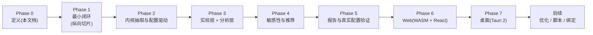

# 路线图

## 方法:纵向切片

::: warning 为什么改掉"先内核后游戏"的顺序
原阶段规划存在依赖倒置:Phase 2 要求"跑完 30 天循环",但 Metrics 排在 Phase 4——没有指标就无法验收 30 天循环。更根本的问题:**先做通用内核再做游戏,容易把抽象做偏**(为想象中的游戏设计接口)。

修正为**纵向切片**:先把最小 RPG 硬编码跑通(含最简指标与一次 A/B 对比),验证闭环成立,再从切片中抽取通用内核。抽象从真实代码中长出来,不从想象中设计出来。
:::

## 总览

::: tip 平台纪律
Web 与桌面排在 Phase 6 / 7,**但它们的架构前提从 Phase 1 起由 CI 门禁强制**:core 可编译 `wasm32-unknown-unknown`、core 依赖树无平台库、并行可退化为串行(见[仿真内核](./04-kernel))。功能后置,边界不后置。
:::

## Phase 0 — 定义(已完成)

核心概念、时间模型、RNG、指标公式、约束判定、路线图,全部成文(即本站)。

## Phase 1 — 最小闭环(纵向切片)

**做**:硬编码最小 RPG([MVP 定义](./16-mvp)):Actor 概率行为 + 解析战斗 + 奖励 + 成长 + 流失机制;按天推进 30 天;[指标公式集](./13-kpi-metrics)的最小实现(WinRate / Power 分布 / 金字与通胀 / 留存流失);CLI `simulate` + `compare`;一次 attack=100 vs 105 的 A/B 报告。

**平台门禁(本阶段起进 CI)**:
- `cargo check --target wasm32-unknown-unknown` 通过(core 不引入任何平台依赖);
- 输出 schema 按 Arrow 契约设计(列名 / 类型可直映射 RecordBatch,见[数据输出](./09-data-output))。

**验证**:
- 确定性快照:同 seed 重跑逐位一致;
- 解析解对照:闭式期望伤害、独立期望收益与仿真均值一致([测试策略](./19-testing));
- MVP 验收七项([MVP](./16-mvp))全部通过。

**验收**:上表七项齐备 → MVP 成立。

## Phase 2 — 内核抽取与配置驱动

**做**:从切片中抽取通用 World / 事件队列 / Clock / 带键 RNG / 在线聚合指标;引入 YAML 配置(Model 与 Scenario 分离)、参数注册表、config_hash、schema_version、公式引擎(加载期编译);Cohort 参数化;内置系统迁入 `systems` 模块,行为不变;Arrow / Parquet 导出以 feature 提供(MVP 的 JSON + CSV 保持默认)。

**验收**:
- 抽取后同一实验结果与 Phase 1 **逐位一致**(重构不改行为);
- 同一份 YAML 在改键序、加注释后 config_hash 不变;
- 改配置不改代码可跑通同一实验。

## Phase 3 — 实验层 + 分析层

**做**:Grid / Random 扫描、replicates 编排、候选并行(rayon)、`sweep` 子命令、基于置信区间的约束判定、比较报告;**DuckDB 分析层(native)**:duckdb-rs 读结果数据集(Parquet / CSV),SQL 事后探索(分 cohort 战力、经济收支等),不进仿真路径。

**验收**:修改参数范围后自动生成候选实验并比较;约束判定输出 PASS / BORDERLINE / FAIL 三态(见[指标](./13-kpi-metrics))。

## Phase 4 — 敏感性与推荐

**做**:OAT 弹性(从网格数据提取)、单参数轴插值推荐区间、Confidence 判据、`recommend` 输出。

**验收**:能从实验结果给出参数区间与置信度,而不是只输出原始数据;区间端点可追溯到插值过程。

## Phase 5 — 报告与真实配置验证

**做**:HTML 报告(图表、KPI、参数对比);**真实配置验证节点**——拿一个真实或公开游戏的数值配置接入跑通全管线;评估 Excel / CSV 配置导入。

**验收**:外部配置(非最小 RPG)端到端跑通 simulate → sweep → recommend,暴露并修复接入层的真实阻力。**已完成**:宝可梦(第一世代关都)案例接入,零模型改动全链跑通,阻力清单与后续候选见[真实配置验证](./21-pokemon-case);CSV 导入以 `params export / import` 落地(见 [CLI](./10-cli))。

## Phase 6 — Web(WASM + React)

**做**:`sandtable-wasm` 薄绑定(run_simulation / validate_config,不放仿真逻辑);React + TS + Vite 前端;DuckDB-Wasm 本地分析;"Try in your browser"——打开页面、导入[项目文件](./09-data-output)或配置、本地跑小中型仿真、图表直接出,零安装。

**进度**:绑定、前端骨架与 DuckDB-Wasm 查询面板已落地(配置编辑 → 本地仿真 → KPI/按天曲线/分群表 → SQL 查询出图,等价测试锁死,见 [Web 端](./22-web));结果导出已落地(`days.csv` / `report.json` 下载,与 CLI `simulate --out` 产物同构);sweep 前端化已落地(单轴网格扫描 + 约束判定表 + 推荐带可视化,JS 逐候选驱动,预算门内本地执行)。

**边界**:Web 只承诺小中型仿真(DuckDB-Wasm 默认单线程、WASM 内存 4GB 上限);万级玩家大型 sweep 引导走 CLI / 桌面。

**验收**:浏览器与 CLI 用同一配置同 seed,结果统计等价([测试策略](./19-testing));结果可由 DuckDB-Wasm 查询并出图。**已完成**:等价由 `web_parity` 测试逐值锁死,DuckDB-Wasm 查询面板落地,见 [Web 端](./22-web)。

## Phase 7 — 桌面(Tauri 2)

**做**:Tauri 2 壳(React UI + Rust 后端),native 仿真 + native DuckDB + 本地文件;面向 Windows 等平台的主力形态,无 Node / Python 后端。

**验收**:桌面端跑通与 CLI 等价的完整实验流;安装包在 Windows / macOS 可用。

**依赖评估(2026-10-10,可开工,无依赖阻塞)→ 已拍板开工(2026-10-10)**:

- **技术面**:Tauri 2.x 为现行稳定线(2024-10 稳定,2026 年仍在活跃维护,updater 插件要求 Rust 1.90+);架构与本节立项一致——`apps/desktop` 壳(见[项目结构](./17-project-structure)壳落点约定)+ `sandtable-core` 以 path 依赖直连(native 仿真,不经 wasm 边界)+ `duckdb-rs` 读 Parquet/CSV(与 Phase 6 native 分析层同一依赖)+ 复用 apps/web 的 React 19 + Vite 8 前端(Tauri 原生支持 Vite 构建产物)。core 侧零改动:CI 门禁已强制 core 可编译 wasm32、依赖树无平台库、并行可退化为串行。
- **CI/打包**:官方 `tauri-apps/tauri-action` 支持三平台矩阵;Windows / macOS runner 零额外依赖(WebView2 / WKWebView 系统自带),Linux runner 需 webkit2gtk-4.1 等约 8 个 apt 包;二进制用系统 WebView,体积远小于 Electron。
- **风险**:代码签名(Windows SmartScreen / macOS Gatekeeper)是发布质量门槛,非技术阻塞;不签名仅影响首次打开体验。
- **拍板结论(2026-10-10)**:① 平台优先级 **Linux 本机先行**(壳在本机开发验收,Windows/macOS 后置);② **暂不引入自动更新器**(验证通道先行手动安装,更新器二期);③ 签名证书**留到发布时再定**;④ 开工顺序:壳 + core path 直连最小可跑 → 前端接入 → 实验流对齐 CLI 验收。
- **进度**:壳已起步并接入前端(2026-10-10)——`apps/desktop/src-tauri`(tauri 2.12 + tauri-build 2.7,workspace member);命令面 6 个(`validate_config` / `run_simulation` / `sweep_plan` / `sweep_candidate` / `sweep_recommend` / `query`)与 wasm 绑定逐字段同构、core 直连不经 wasm 边界、错误前缀同源,native 无 WASM 的 64 replicates / 200 预算门;duckdb-rs(bundled + parquet)已接进 `query` 命令——本地结果文件按词根注册视图跑 SQL,与 CLI `query` 同源(只读结果红线、is_ident 拦注入、DESCRIBE 取列名);`apps/web` 经 `lib/wasm.ts` 桌面分支(`__TAURI_INTERNALS__` 检测 → `invoke`)零改动复用全部 React UI(仿真 + 扫描 + 查询),桌面下走 native 命令面,web 构建产物经 `frontendDist` 内联;**实验流 GUI 四步接线齐(2026-10-11)**:simulate → `run_simulation`、sweep → `sweep_plan` / `sweep_candidate`、recommend → `sweep_recommend` 均已接,`query` 补齐——native 命令接入 UI,新增「本地结果文件分析」面板(tauri-plugin-dialog 选 CSV / Parquet,duckdb-rs 只读按词根注册视图,与 CLI `query` 同源;QueryPanel 加 `loader` / `hint` 扩展点复用表格渲染,与会话内 duckdb-wasm 查询面板分工);桌面等价断言补齐:desktop 与 wasm 绑定同配置同 seed 逐值一致(宝可梦案例,与 web_parity 同口径,desktop↔wasm↔CLI 三角闭合;tsc / 构建 / clippy / 全 workspace 测试过)。**剩余外部验收**:用户本机开窗人工跑通 simulate → sweep → recommend → query 全链(需本机 GUI 环境,自动化断言已尽,不代做)。**安装包链路(2026-10-13)**:`.github/workflows/desktop-package.yml`(`workflow_dispatch` 手动触发,三平台矩阵 ubuntu-24.04 / windows-2025 / macos-15,fail-fast 关——Windows / macOS 编译慢,任一平台失败不中断其它)产出 Windows msi+nsis / macOS dmg+app / Linux deb 制品上传,**不打 tag、不建 Release**(版本号只由用户手动给出,未验收的二进制不进 Releases 页面);前置两步为 wasm pkg 与前端产物(custom-protocol 内联 frontendDist),与 desktop-smoke job 同序;图标源 `apps/desktop/src-tauri/assets/icon.png`(1024×1024 占位:渐变 `#4F46E5→#7C3AED` + "st",重生成方式见该目录 README)经 `tauri icon` 生成全套提交进 `apps/desktop/src-tauri/icons`(conf.json `bundle.icon` 原为空数组,bundler 无图标无法产出 msi / dmg)。本机已实证 bundler 全链:`tauri build --features custom-protocol --bundles deb` 出 `sandtable_0.1.0_amd64.deb`(26.67 MiB,dpkg 元数据正确:Depends libwebkit2gtk-4.1-0 / libgtk-3-0),同一路径覆盖 Windows / macOS 的图标与清单解析,故 CI 三腿是平台二进制差异而非配置差异。**CI 实证(run 38420221169,2026-10-13)**:三腿全绿(windows-2025 6m52s / macos-15 17m36s / ubuntu-24.04 4m41s,二次跑含缓存),制品三份齐——Windows 36.8 MB(msi+nsis)/ macOS 46.5 MB(dmg+app)/ Linux 27 MB(deb);首跑 macOS 腿因 runner 到 github.com 的瞬时网络错(curl 28,75s 超时)失败,重跑即绿,与配置无关(安装步已加三连重试)。**启动冒烟(run 38436094647,2026-10-13)**:Windows / macOS 腿构建后拉起裸二进制判 20s 进程存活——WebView2 / WKWebView 运行库缺失或窗口创建 panic 在此兜住,双腿实证 `alive after 20s`(Win pid=4544 / mac pid=3077);Linux 腿不重复跑(desktop-smoke job 已有带截屏判定的完整启动链门)。安装的运行态验收从「仅编得过」升为「启动链实证」,剩 GUI 交互语义仍归人工开窗。**待验**:三个平台安装包的运行态可用性(Windows / macOS 无 GUI 冒烟手段,CI 只能证明编得过),随桌面端条的人工验收一并做;未签名构建按拍板口径(签名证书留到发布时再定)只影响首次打开提示。

**人工开窗验收清单(2026-10-12 备,照表执行即可;逐项过了在根目录 todo.md 勾掉桌面端条)**:

第 0 步(先跑可复跑的无头冒烟):仓库根 `bash scripts/desktop_smoke.sh`——带 `custom-protocol` 构建 + Xvfb 无头拉起 + 截屏判定 UI 渲染,过了再开窗做下表(少踩环境坑)。**已升为 CI 门(2026-10-13)**:`desktop-smoke` job(debug 构建 + 同配方截屏判定,空白窗 <100 色即 fail)——devUrl/custom-protocol 坑(不带 feature 的构建独立运行即错误页)此前只被人工清单挡过,现启动链回归 CI 直接红;本机 release/debug 双配方复验过(1 582/1 584 色)。首跑即抓到 job 自身漏步:`tsc` 要解析 `sandtable-wasm` 的 file:pkg 类型声明,须先 `wasm-pack build` 再 `npm run build`(与 web job 同序),已补;失败时上传截图/启动日志 artifact 供诊断。

启动(开窗):仓库根 `cd apps/web && npm run build`,回仓库根 `cargo run --release -p sandtable-desktop --features custom-protocol`。**坑(2026-10-12 实测)**:不带 `custom-protocol` 的 `cargo build` 是开发形态——窗口加载 `build.devUrl`(localhost:5173),独立运行只显示 "Could not connect to localhost";该 feature 别名本批补进 `apps/desktop/src-tauri/Cargo.toml`(Tauri 2 模板标配)。改前端调试才用 `npm run dev` + `cargo run`(走 devUrl)。

**无头冒烟证据(2026-10-12)**:进程存活 + 窗口 class=sandtable + 截屏 1 583 色,目检确认完整 UI(预设按钮 / YAML 编辑器 / 参数扫描区 / 桌面独有「本地结果文件分析」面板)——启动链与资产内联通道实证通过;表内六步当时仍需人工开窗,后于 2026-10-13 无头点击走查全部实证(1-4 步见下,5-6 步经手输路径与下载接线绕行 native 对话框,见「第 5-6 步卡点与解卡」)。

**无头点击走查证据(2026-10-13)**:xdotool 点击走查(Xvfb :96 + openbox,同冒烟配方)推进到清单 **1-4 步全部无头实证**:
- **第 1 步**:抓到真 bug——Web 内置宝可梦 SIM 预设缺 `behavior` 块(1752a26 落练级产出面时只更了扫描预设),一键即报「model.training 产出已配置但各分群 p_training 均为 0」;已修(`apps/web/src/lib/presets.ts` 补 behavior + upgrade_* 与 examples/pokemon.yaml 同源)并立守卫 `apps/web/tests/presets.test.mjs`(node --test + pkg-node,全部 TS 内置预设过真实内核 validate/sweep_plan,CI web job 接入);复点 KPI 渲染,config_hash 与守卫一致。
- **第 2+3 步**:扫描面板展开点「运行扫描」,进度逐候选可见(候选 5/6 · 24 次),候选表(6 attack × churn_rate/retention_d7 ±CI95 + PASS 徽章)、单轴折线(CI95 须、绿带推荐区间、基线虚线)、推荐块(推荐区间 [20,220] · Confidence Medium + OAT 敏感性表)全渲染,config_hash 同源一致。
- **第 4 步**:抓到**白屏真 bug 链**——点「查询」整页白屏(进程存活、resize 不恢复);先补顶层 ErrorBoundary(`apps/web/src/components/ErrorBoundary.tsx`,渲染期 throw 不再卸整树,白屏变错误文案+重载按钮)后复现查询,兜出根因 `Invalid argument type in ToBigInt operation`:read_json_auto 把整数列推断成 BIGINT,Arrow Int64 向量在 WebKit(JSC)下 toArray() 即 throw。修法两处:`lib/duck.ts` days 表建表整列转 DOUBLE(DayStat 全数值,2^53 内无损,列名取首行键防漂移)+ toColumns 序列化边界 BigInt 归一 number;复跑查询结果表 30 行渲染、「画折线」下拉默认出图。**边界守卫(2026-10-13 二批)**:toColumns/tableName 抽纯函数模块 `lib/columns.ts`,`tests/columns.test.mjs` node --test 锁死 BigInt 归一(CI web job「前端守卫」step)——该边界同时盖住项目 CSV/Parquet 载入表(read_csv_auto 推断整型列)的同款风险,原「待第 5 步人工复核」的 wasm 侧风险就此关闭;桌面 native 路径(LocalQuery)单元格为字符串不经此边界。
- **坑**:桌面壳资产编译期内嵌,改前端必须重编壳(`npm run build` 不重编壳=窗口跑旧 UI);xdotool 点击偶发丢失(对比像素差判定点击是否生效,丢了就重点);select/textarea 会吃滚轮事件(页面滚动把鼠标放面板外)。
- **第 5-6 步卡点与解卡(2026-10-13 实证)**:native 文件对话框(tauri-plugin-dialog → GTK file chooser)无法可靠无头自动化——`ctrl+l` 不开位置栏、`xdotool type/key --window` 键盘事件不投递、对话框交互后 unmap、`windowfocus` 报 BadMatch;试遍 sidebar 点击(Home/Other Locations)、路径栏、文件列表键入均无效。**绕行:两条等价路径落地并全部无头实证**:① LocalQuery 加工具栏手输路径入口(输入框 + 「加载路径」按钮,追加去重,视图仍按文件词根注册;无头走查:键入 `/home/cui/Downloads/days.csv` → 「已选 1 个文件,视图:days」→ 改 SQL 点「查询」→ 结果表渲染,底层 duckdb-rs 与 CLI `query` 同源);② 下载接线——主窗口改在 `setup()` 用 `WebviewWindowBuilder` 构建(`tauri.conf.json` `app.windows` 置空;配置窗无法事后挂 `on_download`),`on_download` 在 `Requested` 把 destination 改写 `~/Downloads`(WebKit 不写不存在的目录故先建目录;同名按 `stem (n).ext` 去重,n 从 0 起首名即裸名),`Finished` 打 `下载true/false` 供冒烟判定(根因:wry 仅在有 handler 时才注册 WebKitGTK 下载委托,无 handler 则 `decide-destination` 无应答、下载被静默取消)。无头实证:点「下载 days.csv」→ `~/Downloads/days.csv`(3 958 B)、再下→ `days (1).csv`(去重生效)、parquet → `days.parquet`(5 594 B,PYARROW 魔数 + pyarrow 读 30 行×18 列)。**项目包闭环**:工具栏「打包项目(.sandtable)」调 `packProject`(manifest v1、条目按路径排序、逐条 sha256、固定归档时间戳 1980-01-01,与 CLI `project pack` 同规)→ 点击后 `sandtable-web.sandtable`(1 388 B)落 `~/Downloads`,CLI `project check` 报「归档有效」、`project unpack --out` 展出与原编辑器逐字节一致的 scenario.yaml;守卫 `apps/web/tests/project.test.mjs`(pack→unpack 闭环 / 排序与字节确定性 / 改一字节即 sha256 拒 / 路径纪律 / 空拒 / 打包产物过真实内核 validate_config,CI web job 接入)。**剩余人工开窗**:仅 native 对话框 GUI 本身(功能已由手输路径等价覆盖)。

| # | 操作 | 预期 |
| --- | --- | --- |
| 1 | 开窗后选「宝可梦」预设,运行仿真 | KPI 表 / 按天曲线 / 分群表渲染,无白屏无 panic(等价已由 desktop↔wasm↔CLI 测试锁死,此处看渲染与交互) |
| 2 | 切扫描面板,选单轴网格预设,运行 | 进度逐候选可见;候选表 + 单轴折线(CI95 须、判定三色、推荐带)出图 |
| 3 | 读推荐块 | 推荐区间 + Confidence 出现,与 CLI `recommend` 同配置口径一致 |
| 4 | 查询面板(会话内 days 表)跑一条 SQL(如 `SELECT day, gold_supply FROM days ORDER BY day`) | 表格渲染,数值列可画折线 |
| 5 | 「本地结果文件分析」面板 → 选 CLI 产物(先 `cargo run -p sandtable-cli --release -- simulate examples/pokemon.yaml --out sim-out` 产 `sim-out/report.json` 与 `sim-out/days.csv`(Parquet 批次另加 `--features parquet` 且尾随 `--parquet`,需要时再建));对话框多选外,手输路径入口(输入框 + 「加载路径」)为等价路 → SQL | 按文件词根注册视图,查询出结果 |
| 6 | 结果导出菜单下载 days.csv / days.parquet;工具栏「打包项目(.sandtable)」→ `sandtable project check` / 重新导入(下载落 `~/Downloads`,同名自动加 (n)) | 下载成功,check 过,导入后配置与结果可复现 |

六步状态(2026-10-13):**1-4 步无头点击实证过;5-6 步经等价路径(手输路径 / 下载接线 + 项目包按钮)无头实证过**(证据见上「第 5-6 步卡点与解卡」)。剩余仅 native 对话框 GUI 本身与 Windows / macOS 安装包,随桌面端条的人工验收一并做。

失败处置:记下步骤号 + 现象(截图),回仓开修;全过则 Phase 7 验收收口,桌面端条转可解。

## 已立项:Report / Web UI 深化(原计划 Phase 7,2026-10-08)

::: note 编号澄清
原始计划([计划-原始.md](https://github.com/cuihairu/sandtable/blob/main/docs/计划-原始.md))的 Phase 7 是 **Report / Web UI**(HTML Report / Dashboard / Charts / Parameter Comparison / Population / Economy / Progression 七项),与本章 Phase 7(桌面)**编号不同源**。桌面在本章编号下仍未立项;本节立项的是原计划 Phase 7 的剩余项。
:::

**现状对账**:HTML Report 与 Charts 已随 Phase 5 落地(`sandtable report`,见[数据输出](./09-data-output));Parameter Comparison 由 A/B 与扫描判定覆盖。**本批补齐四个缺口**(全部落在 CLI 报告侧,只读产物纪律不变;Web 侧按[22 章](./22-web)小中型定位按需跟进):

| 缺口 | 落点 | 数据源 |
| --- | --- | --- |
| Experiment Dashboard(总览块) | 报告页首:规模 / 时长 / replicates / 种子 / 版本 / config_hash | report.json meta + results |
| Population Analysis(分群画像) | 三分群聚合表 + 条形图;群体分位曲线(p50/p90/p99) | report.json cohort_stats / power_snapshots |
| Economy Flow(经济流) | 产出 vs 消耗双线 + 累计汇总 | days.csv |
| Progression Curve(成长曲线) | 平均战力 + 升级累计 | days.csv |

**验收**:`sandtable report` 对常规产物出全上述板块,端到端测试断言各板块存在;只读产物、单文件自包含两条纪律不破。**已完成**:四缺口全部落地(总览 f158ab2 / 分群+分位 f158ab2+49a1d90 / 经济流+成长 e2cb494),折线图升级多序列(图例、CI 须挂首序列),见[数据输出](./09-data-output)报告契约表。

## 后续方向

- 参数优化:Evolutionary 已落地(2026-10-10,`optimize` 子命令,见[参数扫描](./12-parameter-sweep)自动寻优节);**后续增量裁定(2026-10-10)**:Bayesian 代理模型选型 = 随机森林(GP 留后续——无线性代数依赖、确定性同构、特征重要性可解释、小数据足够);Pareto / 多目标 = 约束感知非支配排序(加权求和被拒,前沿即答案);**Pareto 已落地(2026-10-10,`mode: pareto` + `objectives` 列表,三级字典序 hard_pass → 非支配层级 → 拥挤距离,front0 全前沿落 opt.json;顺带修 GA bug:pop 种群向量停在初始种群致第 2 代起育种读错基因)**;**随机森林代理已落地(2026-10-10,`surrogate` 子命令 train / predict / importance,bootstrap + CART 回归 + 方差削减重要性,种子派生确定性,只读 sweep 产物不进仿真路径)**;
- ~~Parquet-in-browser 依赖评估~~ **已评估(2026-10-10):零新依赖可达成**——浏览器端已有 `@duckdb/duckdb-wasm`(查询层依赖),其原生支持 Parquet 读写:`SELECT * FROM read_parquet(...)` 读入、`COPY (SELECT ...) TO 'x.parquet' (FORMAT PARQUET)` 导出(从 duckdb 文件系统取字节 Blob 下载即可);落地动作只是 QueryPanel 增收 `.parquet` 分支与导出菜单加 Parquet 项,随 [Web 端](./22-web)跟进。**两项均已落地(2026-10-10)**:查询面板收 `.parquet`(read_parquet 装表)、结果导出菜单加 `days.parquet` 项(COPY TO PARQUET 取字节下载)。备选 [hyparquet](https://github.com/hyparam/hyparquet)(纯 JS 零依赖,只读,289KB unpacked,支持 HTTP range 按列懒读)仅在"不初始化 DuckDB 就预览 Parquet"成为真实需求时按需引入;`parquet-wasm`(Rust→WASM,读写全)与既有两块 wasm(仿真 + DuckDB)相叠,边际价值低,不引入;
- 复杂行为脚本:载体已拍板 Python(rhai 缓议),设计与分期见 [scripts/scripting-design.md](https://github.com/cuihairu/sandtable/blob/main/scripts/scripting-design.md);**阶段 0–2 已落地(2026-10-11:外挂模式示例 + `sandtable-python` 绑定 crate + `scripts/templates/` 官方编排模板;maturin 出 `sandtable-sim` wheel,pytest 16 例含 py_parity 与 CLI 逐值一致,wasm 门不回归)**;**阶段 3 已拍板开工(2026-10-11,用户授权自行拍板)**:范围 = 批处理粒度(day-level chunk)回调评估——事件级 Python 回调红线不松(设计稿 §4),只评估「日粒度批量 chunk」形态;第一批 = 性能实测报告先行(设计稿 §7 门槛「先出实测报告再拍板,不预设结论」),**已落地([scripting-perf-report.md](https://github.com/cuihairu/sandtable/blob/main/scripts/scripting-perf-report.md)):日粒度 chunk GO(逐玩家观测面每日一次,30 天挂满 ≈3% 基线;固定成本 ns 级),事件级红线被数据反向证实维持;第二批已落地(读态日钩子:core `DayHook` + Python `run_with_day_hook`,只读不改结果,pytest 对账锁死)**;rhai 维持缓议;Pyodide 维持「前端独立实验,不承诺」不动;
- Python 绑定:扩展模块(maturin + PyO3)主路径已落地(阶段 1–2,`crates/sandtable-python`,`import sandtable_sim`,编排模板见 `scripts/templates/`,发布前按[项目结构](./17-project-structure)命名纪律再核);
- 随机函数扩展(加权表/保底/正态/卡方):设计与分期见[随机函数与概率系统](./24-random-functions);**R1 已落地(2026-10-10):加权表(加载期 CDF + `model.loot.tables` YAML 面 + `ParamKind::Table`)+ 洗牌/无放回加权抽样(A-Res 键序法,Fisher–Yates 带键)+ `disttest` 子命令(均匀/加权 χ²,Cochran 桶合并);新 purpose `Shuffle` 追加在尾不挪旧键,黄金快照逐位不变,params 表 +1(rate_mult)**;**R2 已落地(2026-10-10):保底状态机(硬/软,`Purpose::Gacha = 7` 尾部追加,计数器是 actor 状态不进键)+ 期望抽数 KPI `gacha_pulls_to_hit` 全链接通(比较/sweep/推荐)+ 抽卡案例 yaml(`examples/gacha-pity*.yaml`);闭式对账 2%/50 → 31.79,params 表 +4(53 → 57),黄金快照逐位不变**;**R3 已落地(2026-10-10):正态 Box–Muller(`Purpose::Normal = 8` 尾部追加,双消耗键稳定:改 μ/σ 不挪键)+ `normal_clamped` + χ² 正态分桶(`normal_buckets` 尾部质量并首尾桶,`normal_cdf` 经不完全伽马)+ `disttest normal`;均值/方差 CI 对账,10 万采样 20 桶 χ² 全过,黄金快照逐位不变**;至此 24 章能力清单 7 项全部落地;
- ~~项目导入 / 导出格式定型~~ **格式与 CLI 已定型落地(2026-10-09,manifest v1 + `project pack/unpack/check`,见[数据输出](./09-data-output))**;Web 侧加载项目文件随[Web 端](./22-web)跟进;
- **可信度注记(2026-10-11 拍板,三项一次裁完)**:①「统计 CI 只在模型内有效」立小阶段,**已落地**——措辞沿用[01 章](./01-positioning)立场,落点两处:`sandtable report` 页首一行**模型边界注记**(单文件自包含纪律不破,报告端到端测试锁死其存在),`comparison.json` 的脚本消费面 `scripts/templates/ab_summary.py` 表格尾打同一口径;PNG 不带注记(图内标签英文纪律不变),模板侧验收 = py_compile 门 + 本批对真实 compare 产物跑通;②**真实案例二期与模型校准挂起不立项**——需真实运营数据与对标基准,属用户侧输入,登记待触发;③**桌面端投入维持挂闸门后**(实验流 GUI 人工开窗验收未做,见 Phase 7 状态)。
- **依赖安全与升级勾账(2026-10-11 巡检)**:①pnpm overrides(vite 6.4.3 / katex 0.18.2 / esbuild 0.25.0,`3b5528e`)**复验通过**——`pnpm install --frozen-lockfile` + `pnpm docs:build` 绿(锁解析图只含 pin 版;store 内 vite@5.4.21 / katex@0.16.47 / esbuild@0.21.5 为历史残留,不在锁文件),Dependabot #3/#4/#5 随 pin 转 fixed;②`glib 0.18 → 0.20` **抬不动,如实报方案**:`cargo update -p glib --precise 0.20.0` 被 cargo 拒——`gtk 0.18.2 ← tauri 2.12.2 ← sandtable-desktop` 要求 `glib ^0.18`,tauri 2.x 线依赖面封顶 `gtk ^0.18`(stable 顶格 2.12.2,3.0 仍 alpha.4),patch 不可能换依赖大版;**方案 = 维持 parked,解除条件 = tauri 3.0 stable 且依赖面出现 gtk 0.20 栈**(届时随桌面端大版本一起抬,风险面 = 桌面编译链);Dependabot #7(medium)维持 open,不做 force 抬升,也不为消 alert 改桌面编译链。
- **公式与曲线知识库(2026-10-11 已落地,新增 [25 章](./25-formulas-and-curves))**:定位「程序验证猜想,文档沉淀知识」——知识库章节必须与实现同源,曲线不手画:`crates/sandtable-core/examples/formula_curves.rs` 对代表性表达式调用**真实求值器**逐点采样出 SVG(`docs/assets/formulas/`),表达式编译不过即 panic,文档曲线与求值器能力不可能漂移;图内标签维持英文(不依赖 CJK 字形纪律),正文讲形状语义、数值用途与陷阱;顺带订正 [07 章](./07-config-formula) 一处漂移——能力面把 `lookup(表查找)` 列为现有能力,但求值器 builtin 白名单(7 个:min/max/clamp/floor/ceil/abs/round)并无 lookup,已移出能力面、归回「后续扩展」;
- 游戏引擎 Adapter;Web API(仅当出现真实的服务端需求,local-first 不预设)。

## 节奏约束

- 每个 Phase 结束时文档与实现同步更新,口径不一致以先改文档再改码为准;
- Phase 1 之前不写任何"通用"代码;每个 Phase 有可运行的产出物。
