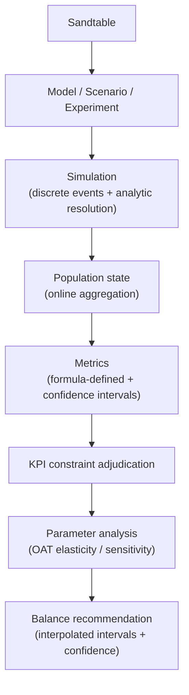

[English](/guide/20-principles-vision) | [中文](/zh/guide/20-principles-vision)

# Design Principles and Vision

## Design Principles

1. **Simulation First**: no pretty UI first;
2. **Deterministic First**: experiments must be reproducible — same seed, same version, bit-for-bit identical;
3. **Configuration Driven**: game data decoupled from the engine (fully configuration-driven once the kernel is extracted);
4. **Engine Agnostic**: no binding to Unity / Unreal / Godot;
5. **Experiment First-Class**: Experiment is a core model, not a script sitting outside the CLI;
6. **Population First**: do not simulate "one average player" — simulate populations and distributions;
7. **Long-Term First**: do not simulate just one battle — at least Day 1 → Day 30;
8. **Measure Before Optimize**: get the simulation, metrics, experiments, and sensitivity right first, then attempt complex optimization;
9. **Relative comparison first**: the value of the output lies in the A/B difference and confidence intervals, not in prophesying absolute values (see [positioning](./01-positioning.md));
10. **Local First**: configuration, experiments, simulation, results, and analysis all happen locally — no account, no server, no database, no network;
11. **One core, many form factors**: CLI / Web / Desktop share one Rust kernel; the simulation is never rewritten for any one platform (see [product boundaries](./02-scope.md)).

## Design Commitments

The following decisions were confirmed in review as the most solid parts of this plan; changing them later requires explicit justification:

| Commitment | Where it lands |
| --- | --- |
| Model separated from Scenario | [Core concepts](./03-concepts.md) |
| Experiment as a first-class citizen | [Core concepts](./03-concepts.md) · [Experiment pipeline](./11-experiment-pipeline.md) |
| Deterministic First | [Deterministic RNG](./06-deterministic-rng.md) · [Testing strategy](./19-testing.md) |
| Measure Before Optimize | [Roadmap](./18-roadmap.md) |
| The MVP is accepted on its closed loop, not on feature count | [MVP](./16-mvp.md) |
| Explicitly listing "what we don't do" | [Product boundaries](./02-scope.md) |
| One core many form factors, and purity of the core (platform gates) | [Simulation kernel](./04-kernel.md) · [Tech stack](./08-tech-stack.md) |

## Final Product Shape



The target user experience:

```text
1. Modify the game configuration
2. Define the experiment
3. Run 10,000 / 100,000 players
4. Advance 7 / 30 / 90 days
5. Inspect the KPIs (with confidence intervals)
6. Compare parameters
7. Find the sensitive parameters
8. Get recommended parameter intervals (with confidence)
```

And not: write code → run scripts → wrangle CSVs by hand → analyze in Excel yourself.

## One-Sentence Definition

> **Sandtable is a configuration-driven simulation and experimentation framework for game systems.**

In Chinese: **Sandtable 是一个面向游戏系统的配置驱动仿真与实验框架,用于长期模拟玩家、战斗、经济和成长系统,并通过实验与指标分析辅助游戏平衡。**

## Vision

Sandtable should ultimately become **the game developer's digital sandtable**. It is not about telling a designer "this skill's DPS is 12,532"; it helps answer "after changing this parameter, what happens to the whole game over 30 days of running".

```text
Combat Simulation
  → Game System Simulation
    → Game System Experimentation
      → Simulation + Experiment + Measurement + Optimization
```

Every expansion step is gated by the validation nodes of the [Roadmap](./18-roadmap.md), not by the vision.
