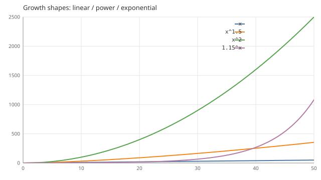
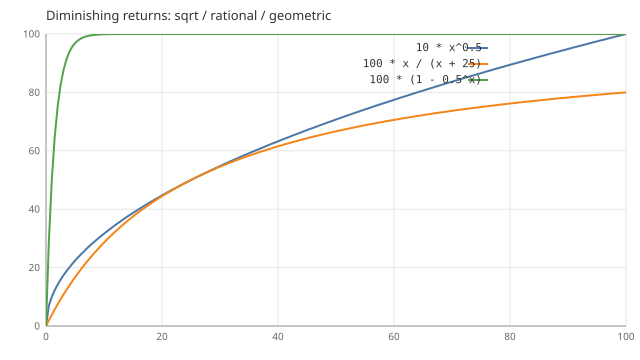
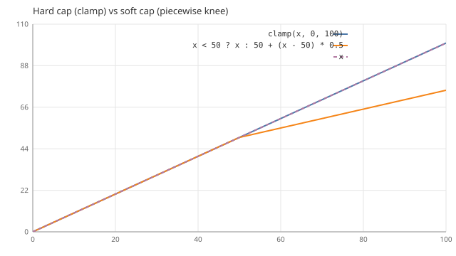
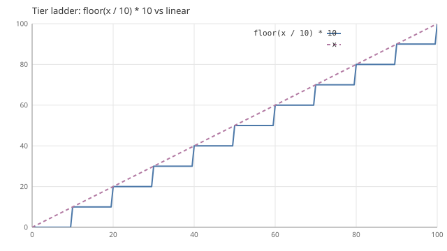
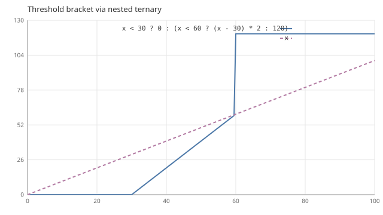

# Common Functions and Curves

The basic vocabulary of numerical design is "function shape": linear, power, exponential, saturating, capped, stepped, piecewise thresholds — the overwhelming majority of balance problems reduce to "pick the right shape, then set the parameters". This chapter expands the capability surface of the [formula engine](./07-config-formula.md) into a **quick reference + curve library**: each built-in function gets its semantics, each common curve gets its figure, its use, and its traps.

::: note Where the figures come from (the program is the single source of truth)
Every curve figure in this chapter is generated by `crates/sandtable-core/examples/formula_curves.rs`: for each expression it calls the **real evaluator** (`formula::compile` + `Formula::eval`) and samples it point by point, writing SVG into `docs/assets/formulas/`. No figure is drawn by hand — if an expression fails to compile, the generator panics outright, so the documented curves cannot drift from the evaluator's capabilities. After changing the evaluator, redraw them:

```bash
cargo run -p sandtable-core --example formula_curves
```
:::

## Built-in functions (7)

| Function | Arguments | Semantics | Typical use |
| --- | --- | --- | --- |
| `min(a, b)` | 2 | Take the smaller | `min(10, x)` caps the gain |
| `max(a, b)` | 2 | Take the larger | `max(1, atk - def)` minimum damage floor |
| `clamp(x, lo, hi)` | 3 | Truncate to the interval | `clamp(x, 0, 100)` hard ceiling |
| `floor(x)` | 1 | Round down | `floor(x / 10) * 10` tier quantization |
| `ceil(x)` | 1 | Round up | Resources consumed in whole units |
| `abs(x)` | 1 | Absolute value | Distance `abs(a - b)` |
| `round(x)` | 1 | Round half away from zero | Integer-izing the display layer |

Boundary behavior (bounded evaluation, hot paths **do not panic**):

- Dividing by 0, modulo 0 → **0** (a crash is not allowed on the simulation's high-frequency paths);
- Fractional powers of negative numbers (`x^0.5` with x < 0) → NaN, and NaN in a comparison is always false — when a curve's domain includes negative values, wrap it in `abs` or make it piecewise first;
- Unknown function names and wrong argument counts error out at **compile time at load**, never at runtime.

## Operators

| Category | Operators | Notes |
| --- | --- | --- |
| Arithmetic | `+` `-` `*` `/` `%` | `%` is floating-point modulo, and likewise "mod 0 → 0" |
| Power | `^` | **Right-associative**; it is power, not XOR (unlike the C family of languages) |
| Comparison | `==` `!=` `<` `<=` `>` `>=` | Yields 1.0 / 0.0 and can join arithmetic directly |
| Logical | `&&` `\|\|` `!` | Yields 1.0 / 0.0; **short-circuiting** (expressions are pure and side-effect free, so short-circuiting is equivalent to full evaluation) |
| Conditional | the ternary `a ? b : c` | Only the selected branch is evaluated; nestable (right-associative), used for piecewise |

Precedence from lowest to highest: `?:` → `||` → `&&` → `== !=` → `< <= > >=` → `+ -` → `* / %` → unary `- !` → `^`. That is, `-x^2` means `-(x^2)`, and a compound condition such as `a < b && c > d` needs no parentheses.

## Capability boundaries (stated honestly)

Built-ins that **do not** exist: `exp` / `log`, trigonometric functions, sigmoid / smoothstep, table lookup (lookup is not at the expression layer), random numbers. When you need them:

| What you want | How to write it today | Notes |
| --- | --- | --- |
| Exponential growth | `1.15^x` | Constant-base power as an approximation, suitable for short ranges; it explodes as x grows, see the figure below |
| Logarithmic (slowdown) | `k * x^0.5` or `k * x / (x + c)` | Power slowdown / rational saturation — usually a perfectly serviceable stand-in for a logarithmic curve |
| S-curve (sigmoid) | piecewise ternary approximation | Only when a smooth knee is genuinely needed; a step or a piecewise form is enough in most cases |
| Linear interpolation | `a + (b - a) * t` | It is arithmetic to begin with, just write it out |
| Real exp / log / table lookup | **do not force it** | Add a builtin per [chapter 07's "Follow-up Extensions"](./07-config-formula.md), or wait for the scripting layer; the loss of readability bought by piling tricks into the expression layer is not worth it |

## Curve library

Labels inside the figures stay in English (the discipline of not depending on CJK glyphs); each section's description says how to read them.

### Growth shapes: linear / power / exponential



| Expression | Shape | Typical use | Trap |
| --- | --- | --- | --- |
| `x` | linear | Basic progression of +N per level; the budget is fully predictable | Not enough incentive late in a long-running game |
| `x^1.5` | gentle power growth | A mild version of "the later it gets, the more expensive / the stronger it gets" | Almost coincident with linear in the early game; players cannot perceive the difference |
| `x^2` | quadratic growth | Power amplifying attribute (e.g. damage ∝ attack²) | A 10× attribute becomes 100× output; stacked with buffs, power inflation is very easy to trigger |
| `1.15^x` | exponential (constant-base power) | Short-term boosts (buffs / events lasting ≤30 levels) | Around x≈58 it overtakes `x^2` and then runs away with it; banned for long-term progression; often combined with `floor` / rounding to make it "double every N" |

Selection rule: **linear before power, power before exponential** — exponential is reserved for short-term systems with a clear end point.

### Diminishing returns: three saturations



| Expression | Shape | Typical use | Trap |
| --- | --- | --- | --- |
| `10 * x^0.5` | square-root slowdown, unbounded | Returns that diminish monotonically but have no ceiling (diminishing marginals still encourage stacking) | Too steep early: the gain from 0→1 is about 6× that from 9→10, which exaggerates the newbie experience |
| `100 * x / (x + 25)` | rational, asymptotic to 100 | Soft caps: hit rate, damage reduction, conversion rate | Parameter c **is** the half-saturation point (exactly 50 at x=c); changing c means moving the knee — do not stack another coefficient on top |
| `100 * (1 - 0.5^x)` | geometric saturation | The feel of "each level's gain halves"; floor probability rising with attempt count | Basically flat after 99%; if you want "there is still something to do late", add step compensation |

All three satisfy "the more you invest, the lower the marginal return"; the difference lies in **whether there is an upper bound, and where the knee is**. For the two with an upper bound, the knee parameters (c and the base) are the main balance knobs.

### Capping: hard ceiling vs. soft ceiling



| Expression | Shape | Typical use | Trap |
| --- | --- | --- | --- |
| `clamp(x, 0, 100)` | hard ceiling, everything past the line evaporates | A fallback for the legal range; capping hit rate / crit rate | Investment past the line returns zero, so players will stack exactly to 100 and stop — if you want "stacking further to still mean something", do not use this |
| `x < 50 ? x : 50 + (x - 50) * 0.5` | knee reduction, half-counted past the line | Soft cap: stacking is still encouraged, overshooting is not punished | The 0.5 slope is the second knob; multi-stage reduction can nest ternaries, but past two stages you should consider a different shape |

Rule of thumb: **use clamp to cut returns, use reduction to preserve the experience**. The dashed line in the figure is the uncapped reference; the whole point of a cap is to pull the curve off the diagonal.

### Quantized tiers



| Expression | Shape | Typical use | Trap |
| --- | --- | --- | --- |
| `floor(x / 10) * 10` | steps of 10 per tier | Tier systems (ranks, quality grades, dungeon difficulty) | Investment at a tier boundary yields no immediate return (the "level 9 for nothing" feeling), so pair it with progress display or a preview of the next tier; the gap between the dashed reference line and the step is the "sunk investment" |
| `round(x / 10) * 10` | snap to the nearest tier | The rounded variant, with a more even feel at the boundary | Floats asymmetrically across the half-tier; keep the reproducibility convention in mind when pairing it with a settlement system |

### Piecewise thresholds



| Expression | Shape | Typical use | Trap |
| --- | --- | --- | --- |
| `x < 30 ? 0 : (x < 60 ? (x - 30) * 2 : 120)` | three segments of threshold / linear / tier jump: 0 below 30, linear to 58 from 30–60, a jump to 120 and capped from 60 up | Battle passes, season missions, unlock-gated rewards | The all-grey stretch below the threshold is the most damaging segment for retention, so it is often paired with a floor starting value or a first-clear reward; the slope of 2 is the "catch-up speed during the compensation period" knob |

Nested ternaries are this engine's standard way to express piecewise structure: conditions are laid out left to right, values go into the branches. At ≥4 segments readability drops markedly — first ask whether that many segments are really needed.

## Combined patterns

Real formulas are almost always composites of the shapes above; two recipes come up often:

```text
Power / damage (steep early, capped late): min(cap, base * x^1.5)
Saturating returns with a threshold: 100 * max(0, x - 20) / (max(0, x - 20) + 25)
```

Tuning mnemonic: **fix the shape first, then fix the parameters; let every parameter do exactly one job** (coefficients govern overall magnitude, exponents / bases govern curvature, clamp / thresholds govern boundaries). When tuning "feel", move one knob at a time — otherwise a change in the curve family cannot be attributed, which is the same discipline as the OAT method of the [parameter sweep](./12-parameter-sweep.md).

## Boundaries with other systems

- The formula layer is a **deterministic pure function**: the same input must yield the same output, and randomness always goes through the [keyed RNG](./06-deterministic-rng.md) — never into a formula;
- Probabilistic facilities such as weighted drop tables, pity systems, and normal distributions live in the dedicated systems of [chapter 24](./24-random-functions.md) (`model.loot` and friends), not at the expression layer;
- Formulas are compiled to an AST at load time and evaluated by variable index, with no string lookup — see the execution-model section of [chapter 07](./07-config-formula.md) for the performance conventions.
