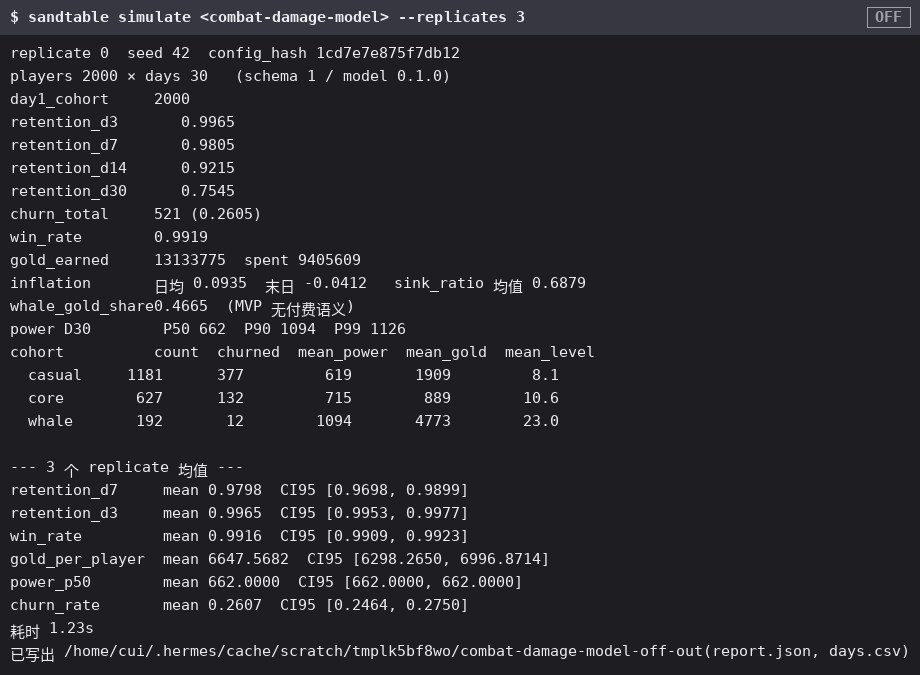
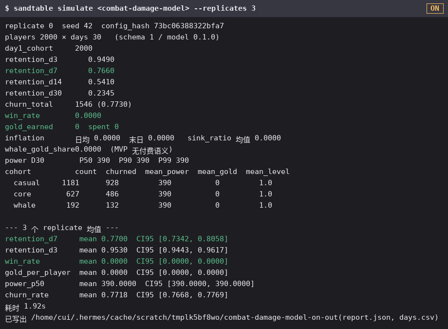
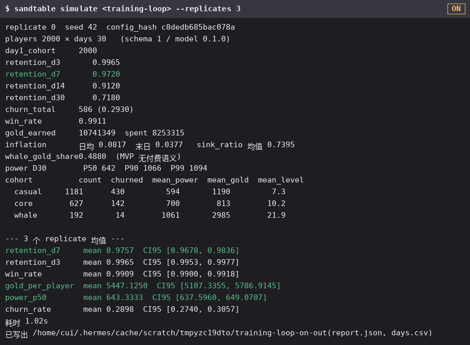
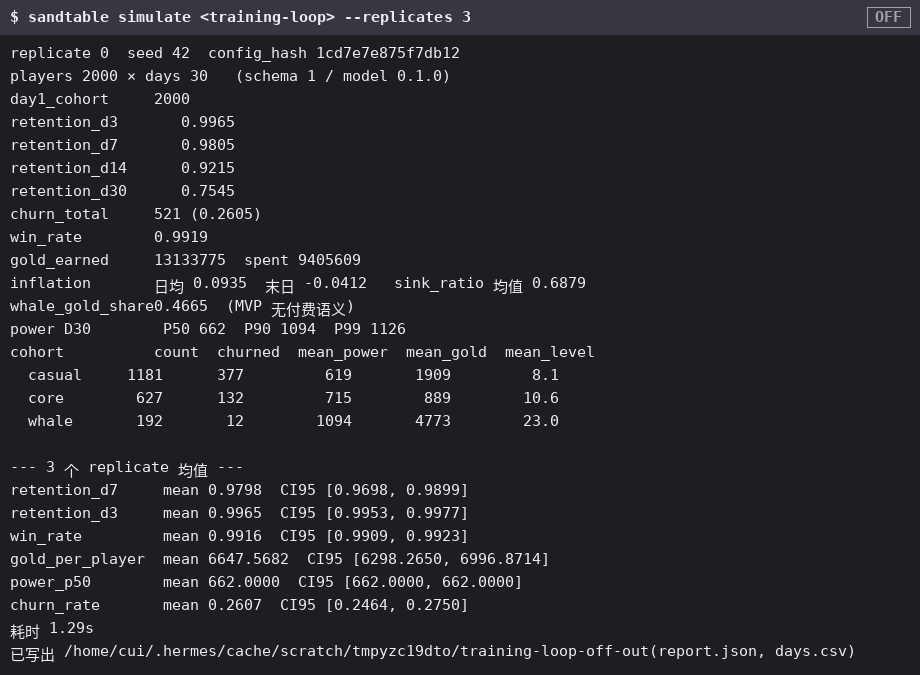
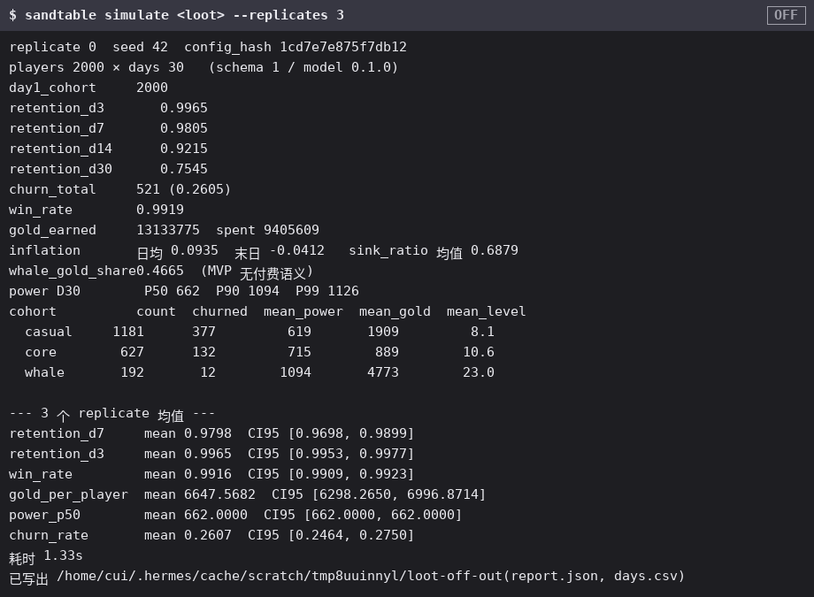
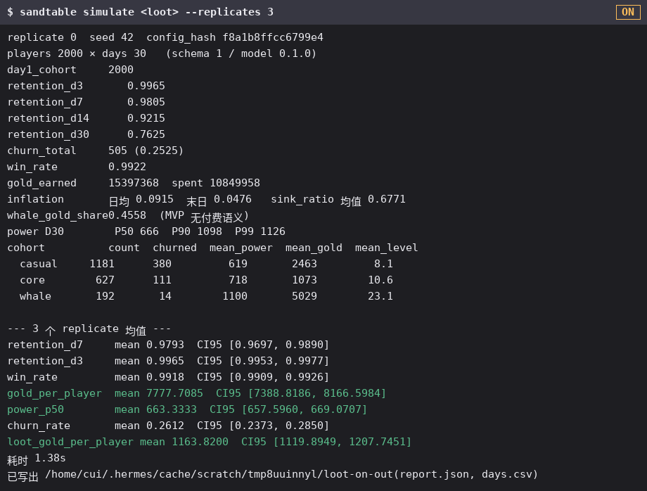
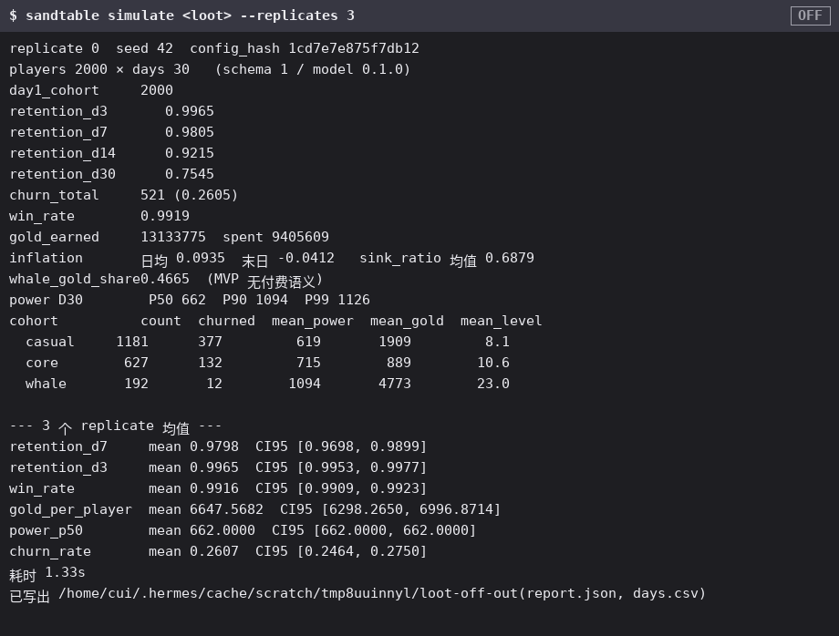
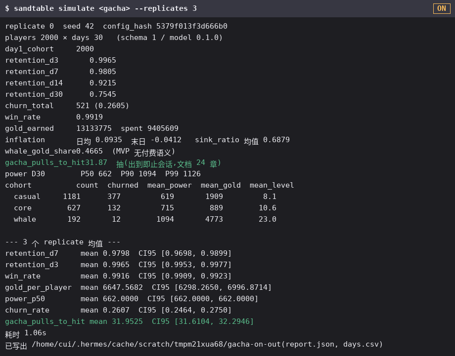
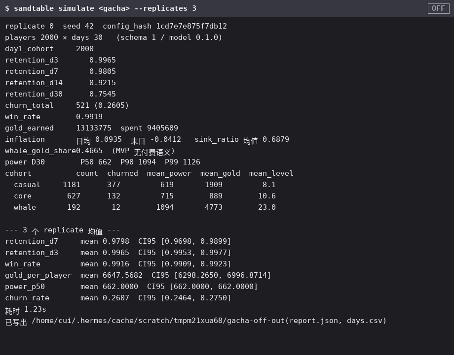

# Config Switch Effects

Every configuration toggle that "changes something once enabled" is listed here, with an **off** screenshot, an **on** screenshot, and an animated GIF of the switch, so the effect of each switch is visible at a glance. The figures are generated by the pipeline below and are real CLI output — nothing is drawn by hand.

::: note Where the figures come from (the program is the single source of truth)
All figures in this chapter are generated by `scripts/config_effects.py`. For each switch it builds an **off** YAML and an **on** YAML, feeds both to the real `sandtable simulate` CLI with the same seed and replicates, and renders the real stdout (plus a synthetic state chip and title). Any configuration or simulation change that alters the output also alters the rendered figure, so rerunning the pipeline doubles as a config-effect regression check. Regenerate them after changing a switch or its YAML:

```bash
python3 scripts/config_effects.py
```
:::

The four switches correspond to the discrete `Option` / convention fields in `model` that change behavior once set. Each entry shows the off and on figures (the animated GIF loops through: off still → on output typed line by line → on still).

## 1 · Combat damage model (`model.combat.damage_model`)

Off = difference convention (default): `dmg = attack − defense`, clamped at 1. On = ratio convention: `dmg = ratio_k·attack/(attack+defense)`. Weak-vs-strong fights stop being a flat floor and shrink smoothly toward zero.





## 2 · Training loop (`model.training` + `p_training`)

Off = no training (default): there is no no-combat growth channel. On = players spend part of their sessions training for xp/gold via the training output surface.





## 3 · Loot settlement (`model.loot`)

Off = no loot (default). On = a weighted-table draw bound on victory, scaling reward amounts by `rate_mult`.





## 4 · Gacha (`model.gacha`)

Off = no gacha (default). On = a pity-layered gacha draw; every player pulls until a 5★ (2% base rate, 50-pull hard pity in the example).




