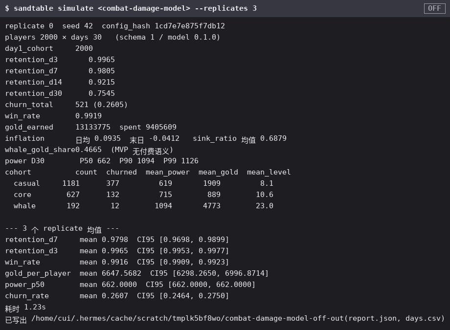
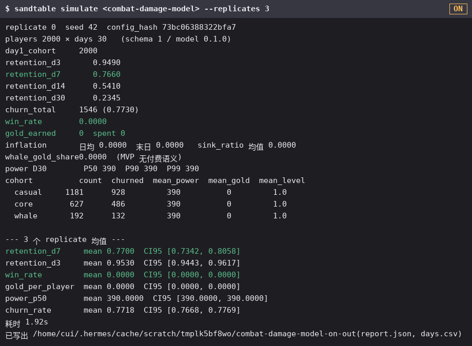
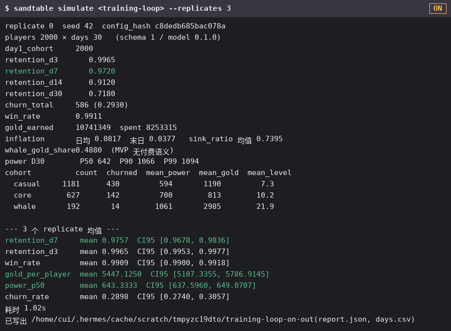
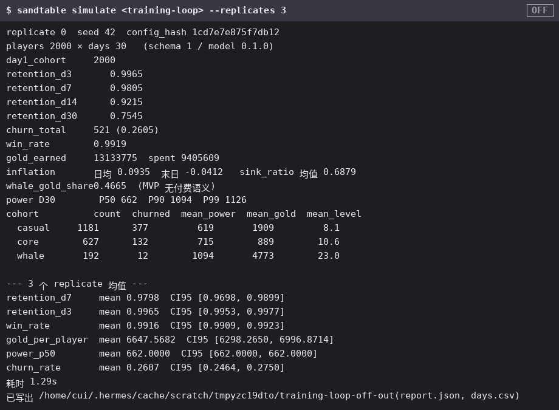
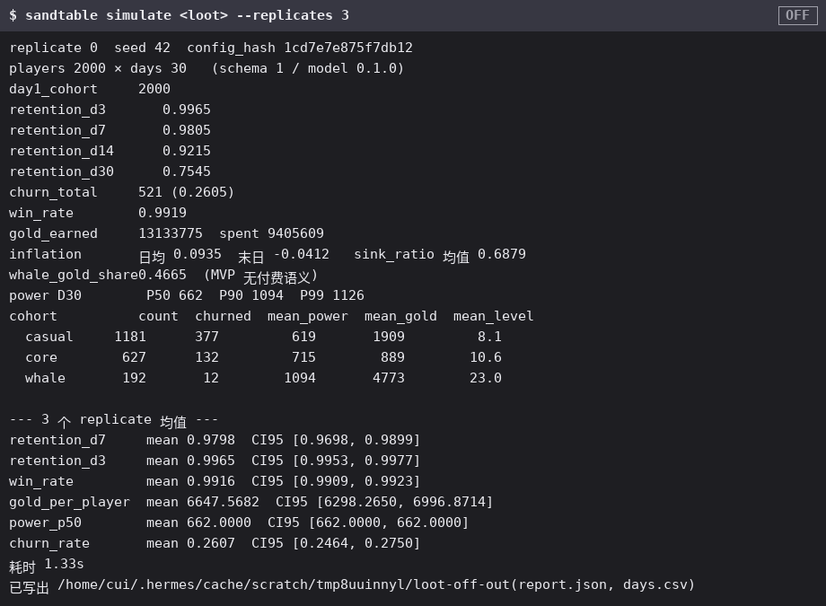
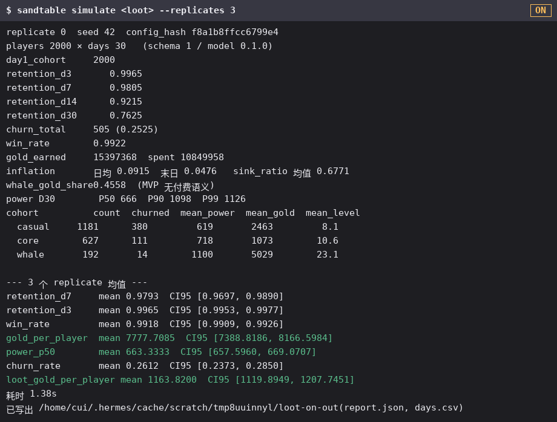
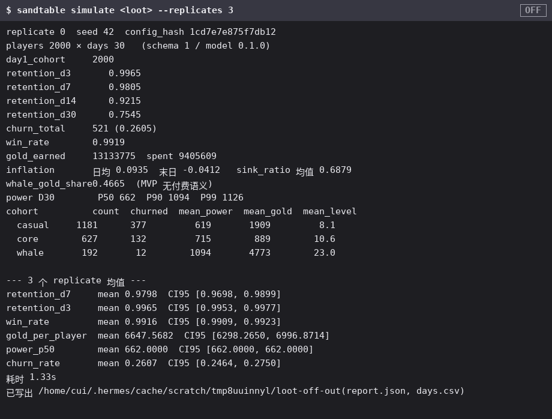
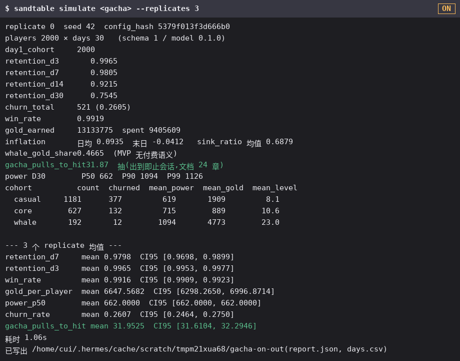
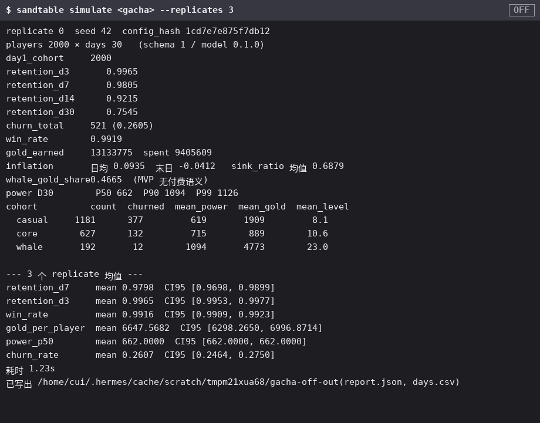

[English](/guide/26-config-effects) | [中文](/zh/guide/26-config-effects)

# 配置开关效果

本仓每个「开启后有效果」的配置开关,都配一张 **off** 截图、一张 **on** 截图和一段切换过程 GIF,一屏看清每个开关的生效差异。图由下方流水线生成、来自真实 CLI 输出,不手画。

::: note 图从哪来(程序是唯一事实源)
本章全部图由 `scripts/config_effects.py` 生成:对每个开关构造 **off**/**on** 两份 YAML,同种子同 replicates 喂给真实 `sandtable simulate` CLI,渲染真实 stdout(外加合成的状态角标与标题)。任何配置/仿真变更改变输出,也必然改变渲染图——重跑流水线即兼作配置效果回归检查。改了开关或 YAML 后重新生成:

```bash
python3 scripts/config_effects.py
```
:::

四个开关对应 `model` 里「一经设置即改变行为」的离散 `Option` / 口径字段。每节给出 off 与 on 图(动态 GIF 循环:off 定格 → on 输出逐行打出 → on 定格)。

## 1 · 战斗伤害口径(`model.combat.damage_model`)

Off = 差值口径(缺省):`dmg = attack − defense`,下限 1。On = 比值口径:`dmg = ratio_k·attack/(attack+defense)`。弱打强不再被钳底,而是平滑趋零。





## 2 · 练级环(`model.training` + `p_training`)

Off = 无练级环(缺省),没有无战斗风险的成长通道。On = 玩家部分会话用于练级换经验/金币(经训练产出面)。





## 3 · 掉落结算(`model.loot`)

Off = 未配置掉落(缺省)。On = 战斗胜利后从绑定加权表抽一次,按 `rate_mult` 缩放数额入账。





## 4 · 抽卡保底(`model.gacha`)

Off = 未配置抽卡(缺省)。On = 接入保底抽卡:每玩家开号抽到 5★ 为止(示例 2% 基础率 + 50 抽硬保底)。




