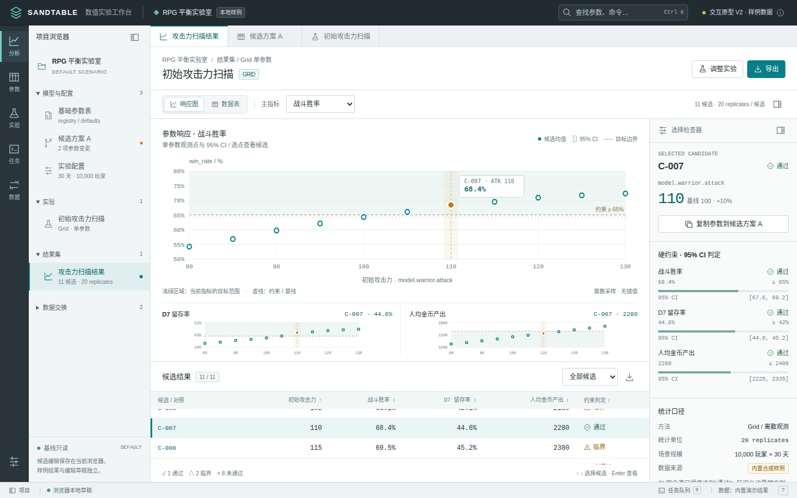
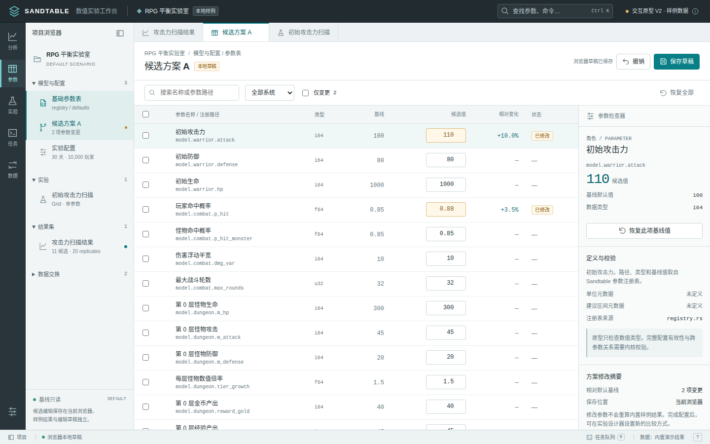
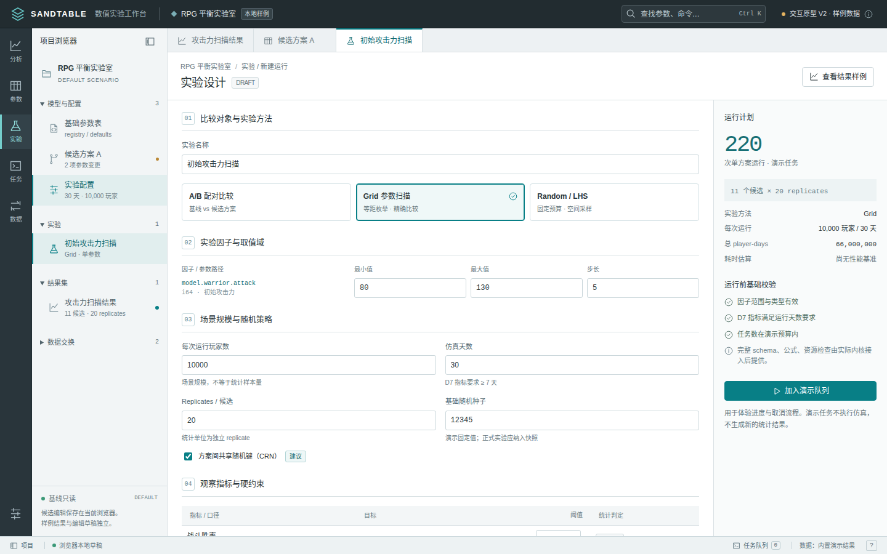
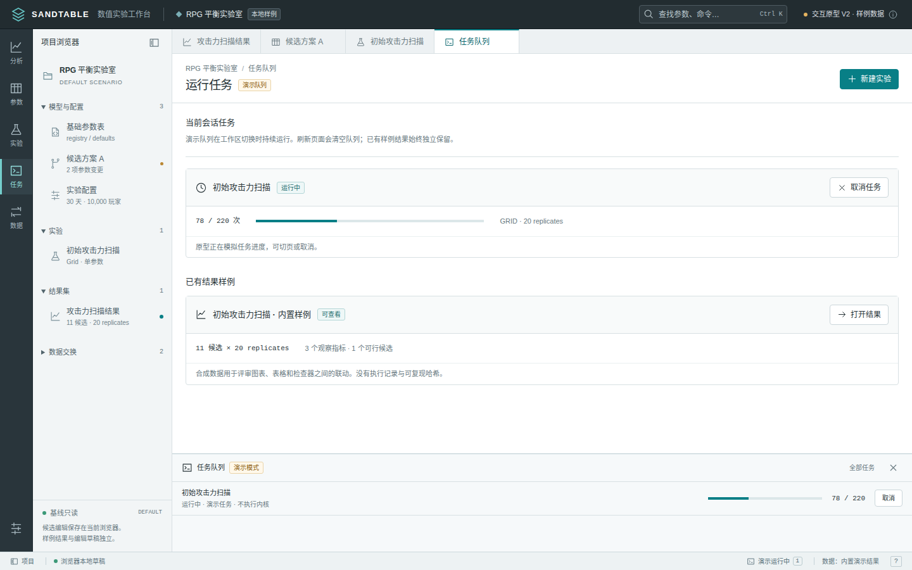
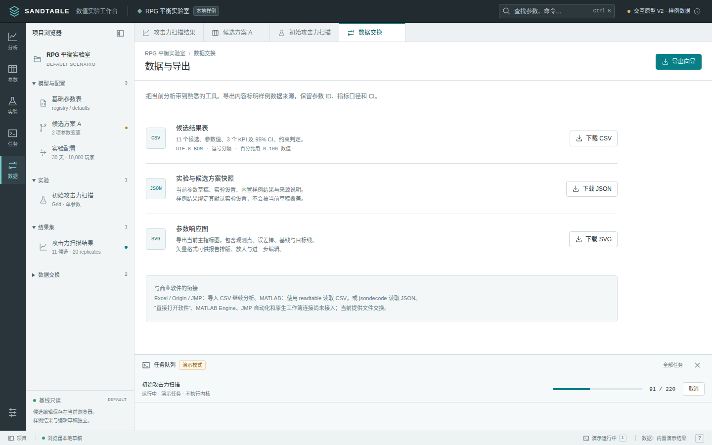
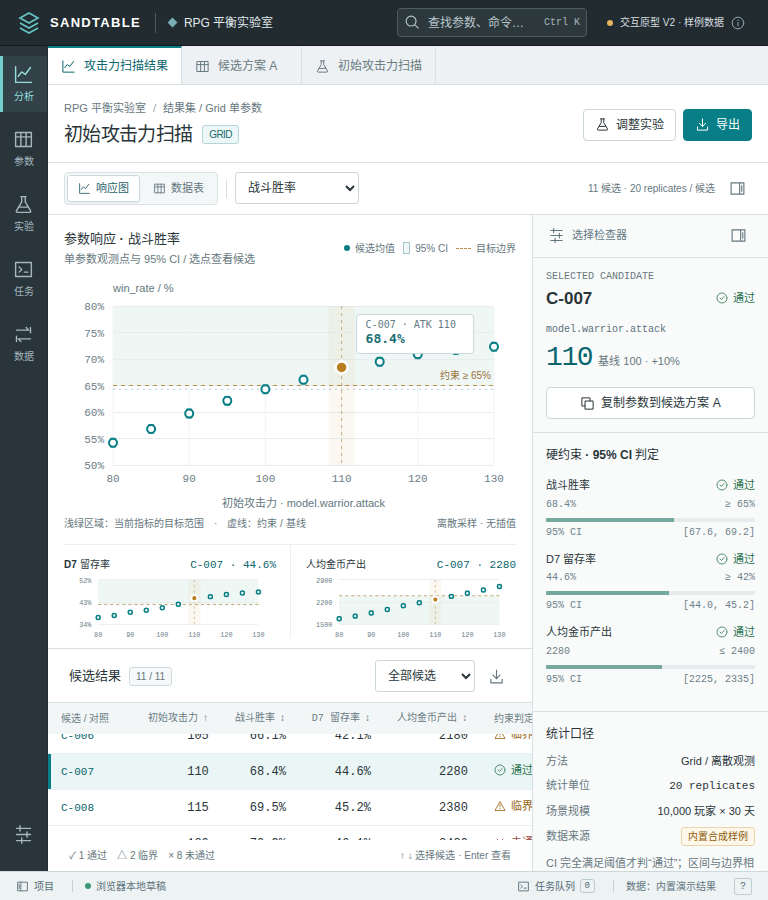

## 架构总览

一个纯 Rust 内核，各消费面并列在旁边 —— CLI、Web 工作台（WASM）、桌面壳（Tauri 2）、Python 绑定与游戏引擎契约。仿真、分析与产物都留在用户本机，链路里没有服务器。实线是业务 / 数据流，虚线是注册表查找：

<figure style="margin:0">
  <picture>
    <source media="(max-width: 720px)" type="image/svg+xml" srcset="/architecture/system-zh-mobile.svg"/>
    
  </picture>
  <figcaption>内核与其配置 / KPI 注册表、各壳之间的数据流；窄屏下为同一内容的竖排改版。</figcaption>
</figure>

图里的 crate 与目录对应关系见[项目结构](/zh/guide/17-project-structure)。

## 界面预览

数值实验工作台 V2（`apps/web` 交互原型，内置合成样例数据）的五个工作区，也是桌面（Tauri）端实现的设计基准（见[桌面对齐基准](../专业工作台桌面对齐基准.md)）：

  <figure style="flex:1 1 460px;margin:0">
    
    <figcaption><strong>结果分析</strong> —— 参数响应图 + 95% CI、候选表与检查器三方联动，看扫描结果与约束判定。</figcaption>
  </figure>
  <figure style="flex:1 1 460px;margin:0">
    
    <figcaption><strong>参数编辑</strong> —— 注册表参数宽表：基线只读、候选值可编辑，支持批量修改与类型校验。</figcaption>
  </figure>
  <figure style="flex:1 1 460px;margin:0">
    
    <figcaption><strong>实验设计</strong> —— A/B / Grid / Random-LHS 方法选择、运行预算与运行前基础校验。</figcaption>
  </figure>
  <figure style="flex:1 1 460px;margin:0">
    
    <figcaption><strong>运行任务</strong> —— 任务队列的进度与取消；已有样例结果独立保留。</figcaption>
  </figure>
  <figure style="flex:1 1 460px;margin:0">
    
    <figcaption><strong>数据与导出</strong> —— CSV / JSON / SVG 下载，保留参数 ID、指标口径与 CI。</figcaption>
  </figure>
  <figure style="flex:1 1 460px;margin:0">
    
    <figcaption><strong>窄屏适配</strong> —— 768px 下图表、候选表与检查器仍可同屏操作。</figcaption>
  </figure>

