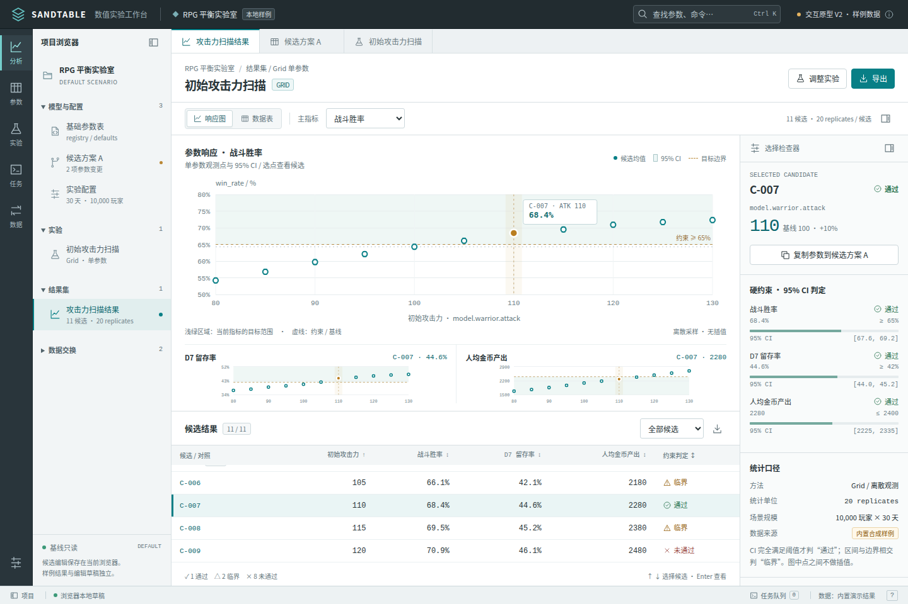
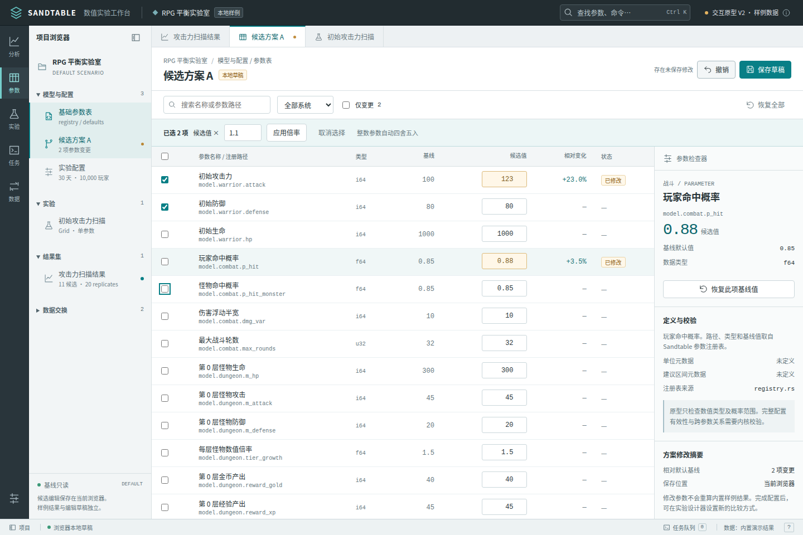
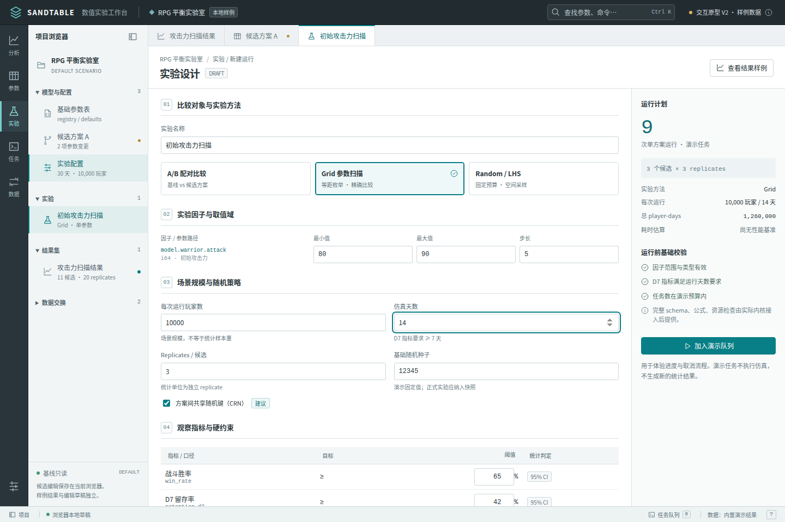

# Sandtable 数值实验工作台 · V2 界面设计

> 2026-10-20。替代首轮原型的页面结构与视觉稿。当前交付为可操作的浏览器原型，未接 Rust / WASM 内核。产品功能总范围继续见[功能蓝图](./专业工作台功能蓝图.md)。

## 1. 用户工作与设计决策

数值策划需要把“改动了什么、如何比较、哪些候选满足要求、下一次试什么”联系起来。因此主工作对象是参数方案、实验定义、候选结果和运行任务。

V2 默认打开**扫描结果分析**。首屏用一个主指标大图和两个辅助指标小图比较离散候选，下方保留候选数据表，右侧检查器解释选中项。分析完成后，用户可把所选参数复制到候选方案，再进入实验设计器。

首轮把参数、运行配置、KPI 摘要和日曲线堆在同一工作台。V2 将这些任务拆成五个工作区，避免在一个页面里混合编辑草稿和已运行的结果。

## 2. 工作区与窗口结构

```text
┌ 应用栏：项目 / 命令搜索 / 原型与数据来源说明 ──────────────────────────┐
│功能轨│ 项目浏览器 │ 文档标签：扫描结果 / 候选方案 A / 实验定义           │
│ 分析 │ 模型与配置 ├────────────────────────────┬──────────────────────┤
│ 参数 │   基线     │                            │ 选择检查器           │
│ 实验 │   候选     │  当前文档工作区             │ 参数、约束、统计口径 │
│ 任务 │ 实验       │                            │ 后续操作             │
│ 数据 │ 结果集     │                            │                      │
│      │ 数据交换   ├────────────────────────────┴──────────────────────┤
│      │            │ 任务抽屉：跨页进度 / 取消 / 进入全部任务            │
└──────┴────────────┴───────────────────────────────────────────────────┘
 状态栏：浏览器草稿 / 运行任务 / 当前数据来源
```

功能轨按用户任务切换；项目浏览器按对象定位。中央采用打开文档标签；检查器只显示当前选择的详情。侧栏和分析检查器可收起。默认桌面视图同时保留图表与可滚动候选表。

## 3. 结果分析工作区

### 页面内容

- 标题：实验名、方法、数据来源；操作：调整实验、导出。
- 工具栏：响应图 / 数据表切换、主指标选择、候选数与 replicates、检查器开关。
- 主图：参数 x 轴、当前 KPI y 轴、离散观测点、95% CI 误差棒、约束线、基线线与所选候选。
- 小多图：另外两个不同量纲的 KPI，保持相同 x 轴，辅助判断改动的代价。
- 候选表：候选 ID、参数值、胜率、D7 留存、人均金币产出、约束判定；基线有文字标记。
- 检查器：当前候选参数值、相对基线变化、每条约束及 CI、整体判定、统计单位和数据来源。

### 选择与编辑边界

点图中观测点、点候选表行或键盘选择表格项，都会同步三个图和检查器。筛选只改变表格范围，图上保留全体观测背景；所选候选始终在检查器显示其 ID。切换主指标会调整轴、单位和阈值。

“复制参数到候选方案 A”复制所选候选的被扫参数，打开参数编辑器。已有样例结果保持其原始快照，不随着编辑草稿改变。

### 统计语义

- `win_rate` 是全程战斗胜率；`retention_d7` 是 D7 留存；`gold_per_player` 是全程人均金币产出。
- 三个量纲分别绘制，CI 的统计单位是 replicate。10,000 玩家属于场景规模，不表示 10,000 个独立实验样本。
- 下限型约束：CI 下界 ≥ 阈值为通过；上界仍低于阈值为未通过；其余为临界。上限型约束反向判定。整体通过要求所有约束通过。
- 离散扫描没有插值模型时只画点与误差棒，不画平滑响应曲线。RF 估计、插值、Pareto 与真实观测在正式产品中需有独立标识。
- 当前原型数据是合成样例，CI 也是用于交互评审的示意区间，不是内核统计输出。
- `days.csv` 是单次 run 日数据；V2 不展示虚构的跨 replicate 日级 CI。逐日分析在正式接入时需明确选择哪个 run / replicate。



## 4. 参数编辑工作区

中央用表格组织：名称与稳定路径、类型、只读基线、可编辑候选值、相对变化、修改状态。右侧显示所选参数定义、来源、类型、元数据缺口、恢复入口和候选修改摘要。

当前原型选取 `registry.rs` 中 18 个参数，覆盖角色、战斗、副本、成长和流失系统。注册表实际含 path / kind / default / desc；显示名按 desc 简化。单位、通用建议范围和影响 KPI 没有统一注册，不编造。

已实现交互：

- 名称 / 路径搜索、按系统分组、只看变更。
- 数值编辑与整数类型检查；概率检查 0–1；错误显示在当前单元格下。
- 多选参数后批量乘以倍率；整数参数取整；任一项校验失败时整批不应用。
- 撤销、恢复单项、确认后恢复全部基线。
- 保存到浏览器 localStorage；刷新后恢复；保存失败不会显示成功。
- Ctrl / Command + S 保存；Ctrl / Command + Z 在非输入编辑状态下撤销。

原型仅做基础前端校验。跨参数关系、公式、负值是否合法等由正式内核决定。浏览器保存不等于写入项目文件。



## 5. 实验设计工作区

中央依次配置四个部分，右侧持续显示运行计划和基础校验：

| 部分 | 必填内容 | 用户需要判断什么 |
|---|---|---|
| 比较对象与方法 | 实验名；A/B / Grid / Random-LHS | 要验证改动还是探索参数域 |
| 因子域 | A/B 方案差异，或 min / max / step / samples | 哪些配置会被实际运行 |
| 场景与随机策略 | 玩家数、天数、replicates、seed、CRN | 场景规模和统计重复是否合理 |
| KPI 与硬约束 | 指标、方向、阈值、CI 判定 | 什么条件才算可行 |

右侧显示候选数 × replicates、单方案总运行数、player-days。没有可靠测量时不显示猜测的耗时。范围、步长、天数、预算或阈值非法时列出原因并禁用排队。

切换实验方法保留已有输入。A/B 比较默认基线与当前候选草稿；Grid 枚举单个整数因子；Random / LHS 提供采样方式与数量。多维因子表、进化优化、Pareto、代理模型属于后续独立实验编辑器，不用失效按钮假装已接通。

“加入演示队列”运行的是进度演示，不调用仿真核心，也不会制造新的结果或配置哈希。



## 6. 任务与数据工作区

任务页显示当前会话的演示任务、进度、取消和结束状态；页面切换不终止任务；底部抽屉随时可开。演示完成与真实仿真完成有明确区别，刷新会清空会话队列。已有合成结果另列为“内置样例”。

数据页提供真实文件下载：

| 产物 | 内容 | 后续工具 |
|---|---|---|
| UTF-8 BOM CSV | 全部 / 当前筛选 / 单个候选，KPI、CI、判定、数据来源 | Excel、JMP、Origin 等可导入 |
| JSON | 当前参数与实验草稿；独立的样例实验快照及结果 | MATLAB / Python 等分析流程 |
| SVG | 当前主指标响应图，内嵌样式与演示数据说明 | 报告和排版工具 |

CSV 百分比使用 0–100 数值并在列名标明 `_pct`。JSON 中当前草稿与样例运行输入分别保存，避免未运行的参数被误认为旧结果的来源。没有实现的商业软件直连只给出文件交换说明。

## 7. 视觉与交互规则

- 应用栏与功能轨采用石墨色；资源浏览器采用浅灰；表格和图表使用白色画布。
- 蓝绿色表示主要操作和观测系列；琥珀色表示所选候选与未保存状态；通过 / 临界 / 未通过同时使用文字与图形。
- 桌面正文 13px，表格 12px，辅助 10–11px；数值、路径和 ID 用等宽字体，数值右对齐。
- 没有大幅宣传区、概览 KPI 卡片或装饰动画；空间优先交给数据。
- 原生按钮、输入、select 和 dialog；明显焦点；命令搜索 Ctrl / Command + K；标签页支持方向键和 Home / End。
- 桌面画布与候选表分别组织；宽表和窄屏图形在局部容器滚动。小屏收起项目浏览器、将检查器放在结果之后。
- 尊重 reduced motion。主操作、编辑、下载和任务状态不依赖 hover。

## 8. UI/UX Pro Max 使用记录

先确定上述任务与信息结构，再检索技能建议：

- `scientific analysis desktop workbench --design-system` 返回营销单列与 Hero/CTA，不适用于此工具，未保存或采用该页面模式。
- 按技能要求重试 `analytics data explorer --domain product`，命中 Analytics Dashboard 的 drill-down / comparative / data-dense 推荐。仅采用对照、下钻和中性灰画布方向；不采用无关 IoT 结果。
- `data table selection keyboard --domain ux` 命中宽表局部滚动、多选批量编辑；无关自动播放视频建议未采用。
- React 栈检索命中受控输入与 TypeScript，但这版独立原型使用无依赖 DOM 模块，不为该推荐引入 React。正式应用沿用仓库 React/Tauri。
- 完成可见焦点、跳过导航、原生对话框、批量编辑、错误定位、reduced motion 和窄屏滚动复核。

旧 Master 中 Financial Dashboard、OLED、Enterprise Gateway 等错配内容已由 V2 的产品专用设计规则替换。

## 9. 已完成检查与限制

无头 Chromium 已实际检查候选联动、指标切换、筛选、排序入口、参数编辑、刷新恢复、批量修改 / 撤销、错误提示、任务入队 / 取消 / 完成、命令搜索，以及 CSV / JSON / SVG 下载。覆盖 1920、1440、1024、768、390px 宽度，检查外层不横向溢出和 reduced motion；未出现 pageerror。

原型入口必须打开 `/prototype/index.html`。旧 `/prototype/` 在 Vite 中曾回退到主应用；开发服务现将其重定向到明确入口。现有生产主应用入口不变。

未完成的生产能力：内核接入、真实项目文件、不可变运行快照、历史数据加载、多维实验、公式 / 曲线编辑、商业软件自动化、权限与协作。它们继续保留在 TODO，不能按原型交付视作完成。
